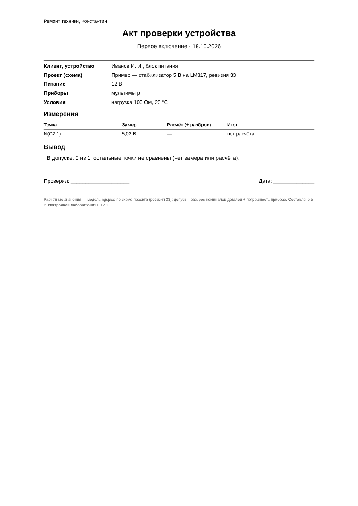

# Итоговый отчёт: версия 1.0.0

Дата: 19.10.2026 · Статус: **проект завершён; автотесты зелёные (Linux и Windows); этапы 7–9 ожидают приёмки**

## Что умеет программа

Офлайн-программа для Windows (портативная, без установки), интерфейс на русском:

- **Схема:**
  - детали по типу и корпусу, карточка детали, каталог реальных деталей с моделями;
  - редактор своих микросхем и корпусов, импорт из KiCad;
  - ERC, экспорт SVG/PNG/PDF.
- **Расчёт ngspice:**
  - рабочая точка, переходный процесс с воспроизведением и стрелками тока, развёртка DC, АЧХ/ФЧХ, параметрический прогон;
  - контроль перегрузок деталей;
  - вкладка «Проверка работы» — итог «работает / не работает».
- **Приборы:** мультиметр, осциллограф, ESR-метр, лабораторный блок питания.
- **Плата:**
  - одно- и двухсторонняя, любой формы, медная заливка (острова удаляются);
  - авторасстановка и автотрассировка в фоне, с перемычками и узкими местами; DRC.
- **Изготовление:**
  - печать 1:1 для ЛУТ, сборочный чертёж;
  - Gerber/Excellon;
  - G-code для CNC 3018 (GRBL) с ПРОЧТИ.txt.
- **Журнал испытаний:**
  - замеры, сравнение с расчётом по допускам, ревизии и откат;
  - **акт проверки для клиента** (PDF или печать).
- **Хранение:** автосохранение и восстановление, Undo/Redo, контрольные версии, перенос `.elab`, полная резервная копия.
- **Примеры (7):**
  - светодиод, RC-фильтр, NE555, стабилизатор LM317;
  - металлоискатель на биениях;
  - блок питания 5 В;
  - заметки.

## Этап 9 — завершение (последние доработки)

- **Акт проверки для клиента** — вкладка «Испытания» → запись → «Акт для клиента»:
  - мастерская (запоминается на этом ПК), клиент и устройство;
  - условия, таблица «точка — замер — расчёт (± разброс) — итог», заменённые детали, примечания;
  - вывод — только по сравнению замеров с расчётом: «все в допуске», «есть расхождения: N», «не все точки сравнены»;
  - строка для подписи; PDF или печать.
- **Пример «Блок питания 5 В»** — типовой ремонтный случай: вторичная обмотка 9 В~, мост на 1N4007, 1000 мкФ, L7805, нагрузка 100 мА.
  - Плата разведена автоматически.
  - Условия проверки работы выполняются в ngspice: выход 4,8…5,2 В, пульсации на выходе меньше 50 мВ, вход L7805 не ниже 7,5 В.
  - Сетевая часть на плату не ставится — это сказано в описании.
- **Перегрузка выпрямительных диодов считается правильно:**
  - средний прямой ток (IF(AV)) — со средним за вторую половину расчёта;
  - пики заряда конденсатора — с ударным током (IFSM).
  
  Раньше обычный выпрямитель с конденсатором ошибочно показывал «перегрузку» по пиковому току.
- **Руководство пользователя** — [USER_GUIDE.md](../USER_GUIDE.md): запуск, схема, расчёт, плата, изготовление, журнал и акт, чего программа не делает.
- **Выпуск на GitHub.** Когда создан выпуск с меткой `v1.0.0` (Releases → Draft a new release), проверка GitHub Actions сама прикрепляет к нему портативный архив для Windows. Такой архив хранится постоянно, а артефакт проверки — 30 дней. Создать выпуск из этой сессии GitHub не разрешает — это одно нажатие в интерфейсе GitHub.

## Проверено

| Набор | Результат |
|---|---|
| Проверка типов | без ошибок |
| Unit | 193 пройдено, 0 ошибок |
| Integration (ngspice) | 101 пройдено, 0 ошибок |
| E2E (Electron) | 24 пройдено, 1 пропущен (портативный `.exe` — только Windows) |
| GitHub Actions (Linux и Windows) | зелёные на коммите выпуска |

## Что остаётся за пользователем

- **Приёмка этапов 7, 7+, 8, 8а, 8б, 8в, 9** — по разделам «Как проверить» в отчётах.
- **Проверка на железе:**
  - первая плата на CNC 3018 — пробная (изоляция на обрезке, карта высот);
  - Gerber перед заказом — в просмотрщике;
  - металлоискатель — на макете.
- **Не сделано и почему:**
  - **Расчёт ngspice в браузерной демо-версии.** Нужна сборка ngspice в WebAssembly. Готовой пакетной сборки в доступных источниках нет, сеть сборочного окружения закрыта. Демо показывает интерфейс, программа для ПК считает.
  - **Схемы с КМОП-логикой считаются долго:** металлоискатель — переходный процесс и проверка работы около 30 с, прогон по L1 — около 1,5 мин. Предел одного расчёта поднят с 30 с до 120 с, чтобы на медленном ПК расчёт не обрывался.
  - **Микроконтроллеры не моделируются.** Детали без модели рисуются и разводятся, расчёт честно отказывает.
