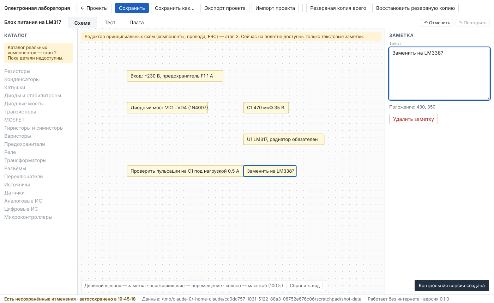
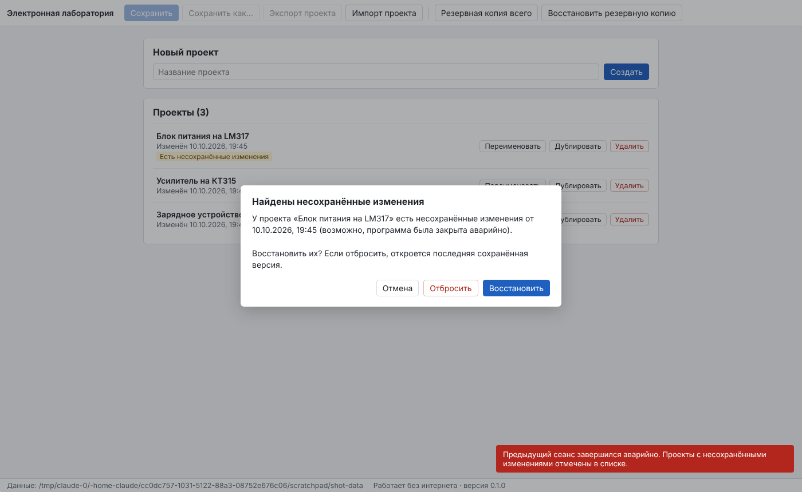

# Отчёт: этап 1 — фундамент, сохранение, перенос и бэкап

Дата: 10.10.2026 · Версия 0.1.0 · Статус: **реализован, ожидает приёмки пользователем** (нужна проверка на Windows-ПК по чек-листу ADR-0001).

## Реализовано

- **Документы:** [ТЗ](../TZ.md), [архитектура](../ARCHITECTURE.md), [план и критерии](../PLAN.md), [правила](../CLAUDE_RULES.md), [тесты](../TESTS.md), [ADR-0001](../adr/0001-desktop-shell-and-portability.md) (Electron 43.6, офлайн, портативность, путь для ngspice).
- **Модель проекта v1** — единый документ с UUID у каждой сущности; символ / деталь / корпус с явным `pinMap` / модель / аннотации разделены; проверка целостности (повторы ID, висячие ссылки, выводы, `refDes`, вывод в двух сетях); миграции версий (цепочка проверена на фикстуре v0); согласованное переназначение UUID.
- **Хранилище:** атомарная запись (tmp → fsync → rename), очередь операций, `.bak` прошлого сохранения, автосохранение в рабочую копию, восстановление после аварии, признак незавершённого сеанса, блокировка второй копии, корзина вместо удаления, журнал операций.
- **Проекты:** создать, переименовать, дублировать, удалить, открыть; «Сохранить», «Сохранить как»; индикатор «Сохранено / автосохранено / ошибка»; вопрос при закрытии окна и при выходе из проекта.
- **Undo/Redo** (Ctrl+Z, Ctrl+Y, Ctrl+Shift+Z, кнопки с подписью действия; набор текста и перетаскивание — один шаг), **контрольные версии** (автоматически при каждом сохранении — последние 20, вручную с подписью — без ограничения, возврат с автокопией текущего состояния и отменой).
- **`.elab`** — ZIP: `manifest.json` (формат, версия, размер и SHA-256 каждого файла), `project.json`, контрольные версии, вложения. Отказ на повреждённых, подменённых, более новых файлах, опасных путях и повторяющихся ID; при совпадении ID — «Заменить» или «Как копию».
- **Полный бэкап `.elabbak`** — все проекты (включая несохранённые рабочие копии), личный каталог, настройки, журнал. Восстановление: сначала полная проверка, затем автокопия текущих данных, затем замена; прерванная замена исправляется при следующем запуске.
- **Интерфейс** на русском: вкладки «Схема», «Тест», «Плата», каталог слева, полотно в центре (сетка, масштаб, панорама, текстовые заметки), свойства справа. Неготовое помечено «этап N», фиктивных данных нет.
- **Офлайн:** CSP `default-src 'self'`, сетевые запросы окна блокируются, автотест запрещает сетевые API в `src/`.
- **Портативная сборка для Windows** `ElectronLab-0.1.0-win-x64-portable.zip` (~145 МБ): `ElectronLab.exe` + `portable.flag`, данные в `data\` рядом с программой.
- **CI:** GitHub Actions на Linux и Windows — типы, unit, integration, e2e в окне Electron, сборка и запуск портативного пакета, архив Windows как артефакт.




## Проверено (автотесты, этот прогон)

| Набор | Результат |
|---|---|
| Проверка типов: ядро и хранилище (строго) | без ошибок |
| Проверка типов: интерфейс и оболочка (по упрощённым объявлениям, см. ограничения) | без ошибок |
| Unit (`tests/unit`) | 32 / 32 |
| Integration (`tests/integration`), включая SIGKILL посреди записи ×6, перенос между двумя папками данных, бэкап на чистый ПК, структуру Windows-архива | 19 / 19 |
| E2E в окне Electron (`tests/e2e`), включая аварию, закрытие, перенос ПК 1 → ПК 2 → ПК 3, портативный пакет | 7 / 7 |

Критерии этапа 1 из [PLAN.md](../PLAN.md): 1–9 выполнены и проверены автотестами; 10 — за пользователем.

## Ограничения и честные оговорки

1. **На реальном Windows я не запускал.** В среде разработки нет Windows и Wine. Windows-архив собран из официального Electron (контрольная сумма сверена), его состав проверен тестом; тот же портативный режим проверен e2e на Linux-сборке Electron той же версии. В CI добавлен прогон на `windows-latest` — его результат будет виден в GitHub Actions после первого запуска. Окончательно — чек-лист ADR-0001 на ваших двух ПК.
2. **Типы React/Electron** в этой среде проверялись по упрощённым объявлениям (npm-реестр отсюда недоступен). Полная проверка с настоящими `@types` выполняется в CI (`npm run typecheck`).
3. Иконка и сведения о версии в `.exe` — стандартные от Electron (для замены нужен rcedit под Windows). Установщика пока нет — только портативный архив.
4. Восстановление из бэкапа заменяет все данные (с автокопией для отмены); выборочное слияние — через «Импорт проекта».
5. Лимиты архива: 2 ГБ сжатого, 4 ГБ распакованного; файлы целиком читаются в память.
6. На полотне сейчас только текстовые заметки — это тестовая нагрузка для истории/автосохранения, а не редактор схем.

## Файлы и коммиты

```
docs/        TZ.md, ARCHITECTURE.md, PLAN.md, CLAUDE_RULES.md, TESTS.md, adr/0001-…, reports/stage-1.md
src/core     model, integrity, migrations, factory, remap, history, ids, result, appinfo
src/storage  store, elab, backup, zip, fsutil
src/main     main, ipc, paths        src/preload  preload        src/shared  api
src/renderer App, useEditor, Dialogs, ProjectList, SchematicCanvas, Panels, styles.css, index.html
tests/       unit (4), integration (3 + дочерний процесс аварий), e2e (2 + launch), fixtures (v0, повторы ID, версия из будущего)
scripts/     build.mjs, package.mjs, make-examples.mts
examples/    пример-заметки-блок-питания.elab
.github/workflows/tests.yml
```

Коммиты — см. `git log` (по одному смысловому изменению: документы → ядро → хранилище → оболочка → интерфейс → e2e → сборка/CI/отчёт).

## Что дальше

1. Вы проверяете портативную сборку на двух Windows-ПК по чек-листу ADR-0001 и подтверждаете этап 1.
2. Затем, по разделу 10 ТЗ, — **этап 1b: сквозной вертикальный прототип** R + C + источник → netlist → расчёт ngspice → показания щупов → `.elab` → простая плата; первым шагом — ADR-0002 с пробным запуском ngspice на вашем ПК. Порядок «1b перед 2» требует вашего согласия.
