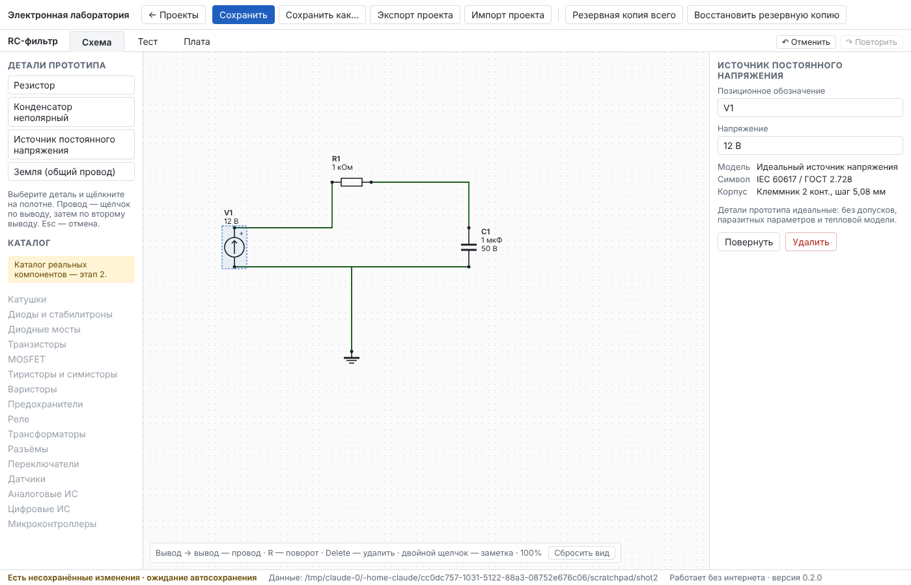
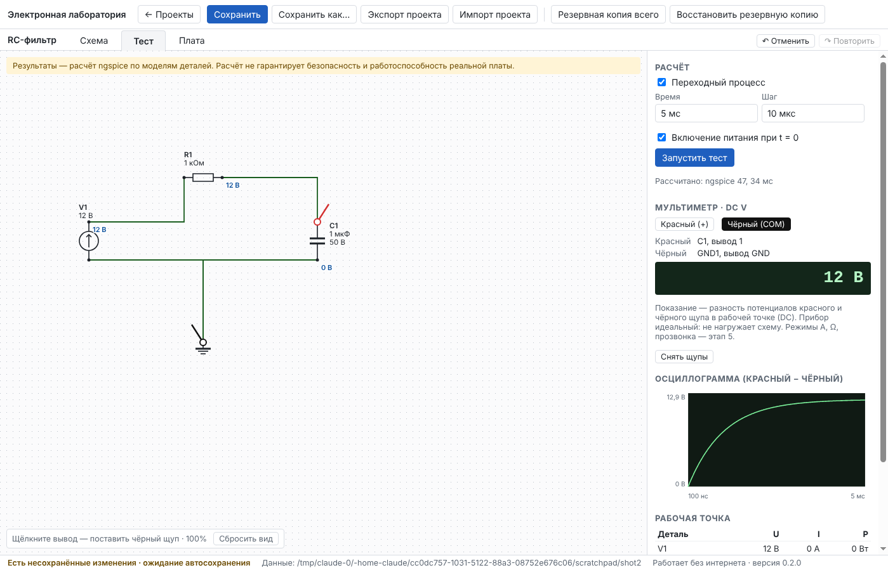
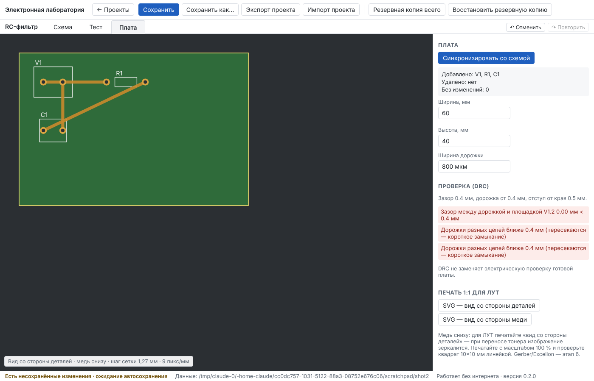

# Отчёт: этап 1b — сквозной вертикальный прототип

Дата: 11.10.2026 · Версия 0.2.0 · Статус: **реализован, автотесты зелёные на Linux и Windows; ожидает приёмки пользователем.**

Цель этапа (раздел 10 ТЗ) — проверить архитектуру насквозь, прежде чем расширять каталог: схема R + C + источник → сохранение → netlist → настоящий расчёт → показание щупов → переносимый файл → простая плата. Всё это работает и проверено автотестами через интерфейс.

## Реализовано

- **Формат проекта v2** с миграцией v1 → v2 (фикстура и тест): координаты выводов и вид УГО, геометрия площадок и контур корпуса, концы проводов и дорожек, модель «опорный узел», настройки расчёта.
- **Детали прототипа:** резистор, конденсатор (с допустимым напряжением, на схеме видно «C1 1 мкФ 50 В»), источник постоянного напряжения, земля. Символ, корпус, явное соответствие «вывод ↔ площадка» и модель — отдельные сущности (ТЗ, раздел 2). Детали идеальные — это сказано в свойствах.
- **Схема:** размещение из каталога, перемещение, поворот (R), удаление (Delete), провод «вывод → вывод», объединение и разделение цепей, позиционные обозначения с проверкой, ввод номиналов в привычном виде («4,7к», «1 мк», «М» ≠ «м»). Связность хранится сетями, провод — только изображение; провода разных цепей не накладываются друг на друга.
- **Расчёт ngspice-47** ([ADR-0002](../adr/0002-ngspice-integration.md)): проверки до расчёта (нет земли, неподключённый вывод, висящий узел, нет пути постоянного тока, закороченный источник, недопустимый номинал, нет модели), netlist, отдельный процесс с таймаутом, рабочая точка и переходный процесс («включение питания при t = 0» или из рабочей точки), понятные ошибки ngspice, исходный netlist доступен.
- **Вкладка «Тест»:** мультиметр DC V с красным и чёрным щупами на выводах, осциллограмма «красный − чёрный», потенциалы узлов на схеме, таблица U/I/P, предупреждения о перегрузке («риск перегрева… оценка без тепловой модели», «риск пробоя»). Если схема изменилась, старые показания не выводятся. Перестановка щупов и перемещение деталей расчёт не «устаревают» — актуальность сверяется по электрическому ключу схемы.
- **Вкладка «Плата»** (односторонняя, медь снизу): синхронизация со схемой с отчётом (добавлено / удалено / без изменений / проблемы), перемещение и поворот корпусов, дорожка только между площадками одной цепи, неразведённые соединения, DRC (край платы, зазоры, пересечение дорожек = короткое замыкание, «чужая» дорожка после изменения схемы), SVG 1:1 в миллиметрах с квадратом 10×10 мм — вид со стороны деталей (для ЛУТ при меди снизу) и со стороны меди.
- **Поставка ngspice:** официальная Windows-сборка ngspice-47 с SourceForge в портативном пакете, SHA-256 закреплена (`scripts/ngspice-win.json`); в Linux CI — системный пакет.

## Проверено

| Набор | Локально | CI Linux | CI Windows |
|---|---|---|---|
| Проверка типов | без ошибок | без ошибок | без ошибок |
| Unit | 62 / 62 | ✓ | ✓ |
| Integration, включая эталонные задачи на настоящем ngspice | 31 / 31 | ✓ (системный ngspice) | ✓ (ngspice-47 с SourceForge) |
| E2E в окне программы, включая сквозной прототип | 8 / 8 | ✓ | ✓ |

Эталонные задачи сравниваются с аналитикой в допуске: делитель (5 В, 0,5 мА, знак тока источника), делитель 3:1, перегрузка резистора 0,36 Вт > 0,25 Вт, заряд RC при τ = 1 мс (63,2 % при t = τ, 99,3 % при 5τ), перенапряжение конденсатора, вырожденная схема, таймаут, отсутствие ngspice.

Сквозной e2e-сценарий: делитель в интерфейсе → 2,5 В → щупы наоборот −2,5 В → R2 = 4,7 кОм: старое показание скрыто, после перезапуска 1,599 В (5 · 4,7 / 14,7) → без земли расчёт не выполняется, причина названа → плата: запрет дорожки между разными цепями, три дорожки, DRC чист → SVG 1:1 → `.elab` → другой ПК: связи, щупы, дорожки на месте, тот же результат.

## Что нашли тесты и что исправлено по ходу

1. Удаление детали или провода в схеме до синхронизации платы делало документ «нецелостным» — его нельзя было бы сохранить. Теперь это законное «несинхронизированное» состояние, которое показывают отчёт синхронизации и DRC.
2. Провода разных цепей ложились друг на друга и выглядели как соединение — добавлена трассировка в обход чужих цепей и выводов.
3. Постановка щупа «устаревала» расчёт — актуальность теперь сверяется по электрическому ключу схемы.
4. Стрелка в символе источника ЭДС была направлена от «+» — исправлено по ГОСТ.

## Ограничения (честно)

- Только идеальные R, C, источник постоянного напряжения и земля; без допусков, паразитных параметров и тепловой модели. Каталог реальных деталей — этап 2.
- Анализы — рабочая точка и переходный процесс; AC и параметрические прогоны, пауза и скорость воспроизведения — этап 4. Мультиметр — только DC V; амперметр, омметр, прозвонка, ESR, лабораторный БП — этап 5.
- Редактор схемы минимальный: нет меток цепей, узлов на проводе, ручной ломаной провода. Полноценный редактор и ERC — этап 3.
- Плата: только прямые дорожки (обходить препятствия — перестановкой и поворотом корпусов), без переходных отверстий, заливок и двух слоёв. Печать — через SVG (открыть и напечатать с масштабом 100 %); PDF-диалог печати и Gerber/Excellon — этап 6. DRC не заменяет проверку готовой платы.
- Контрольная сумма ngspice закреплена по первой загрузке с официального SourceForge через HTTPS: подлинность первого архива подтверждена только источником, дальнейшие подмены ловятся.
- В Linux-пакет ngspice не входит (используется системный). Целевая платформа — Windows.
- На ваших ПК ещё не проверено: в портативной Windows-сборке теперь есть ngspice — стоит пройти чек-лист ADR-0001 и на вкладке «Тест» нажать «Запустить тест».

## Что дальше

Этап 2 — каталог реальных компонентов (резисторы, конденсаторы, диоды, транзисторы и т. д., редактор микросхем и корпусов, импорт по партномеру с подтверждением) по [плану](../PLAN.md), после вашей приёмки этапа 1b.
