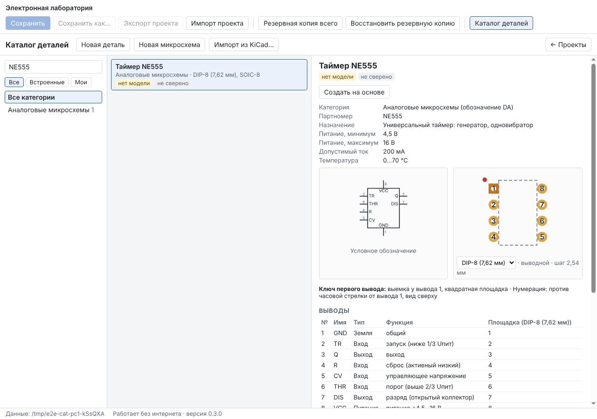
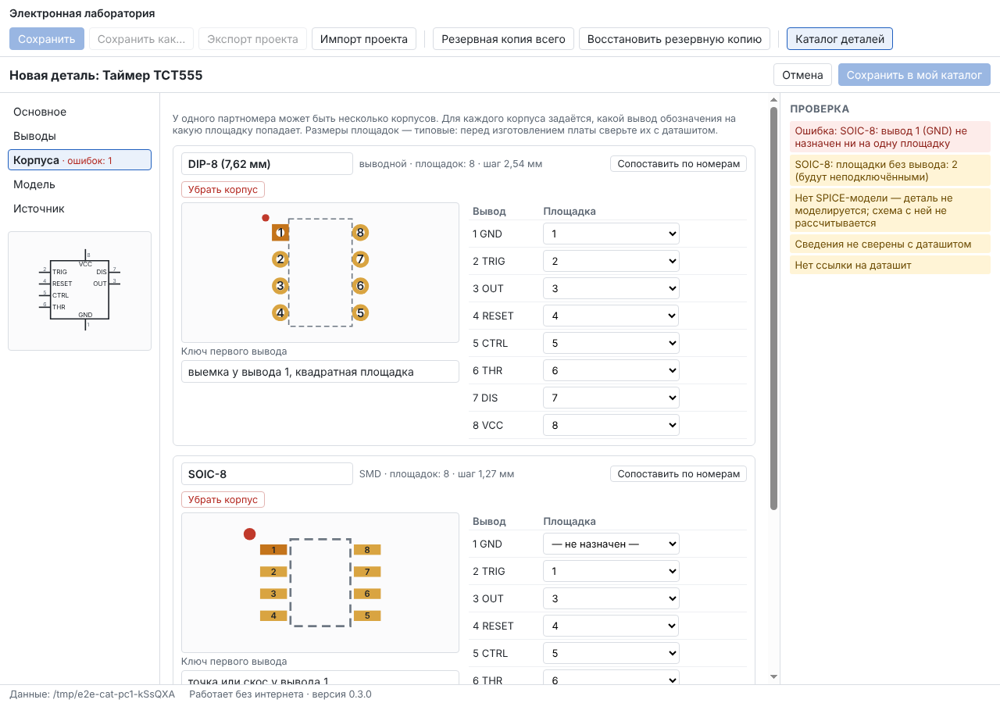
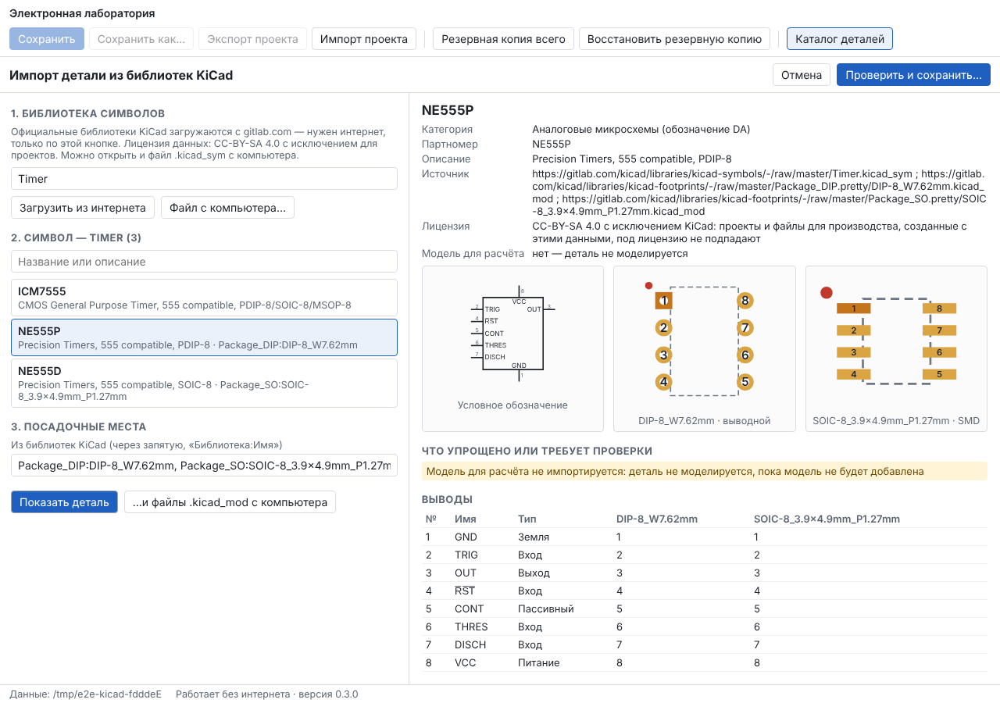
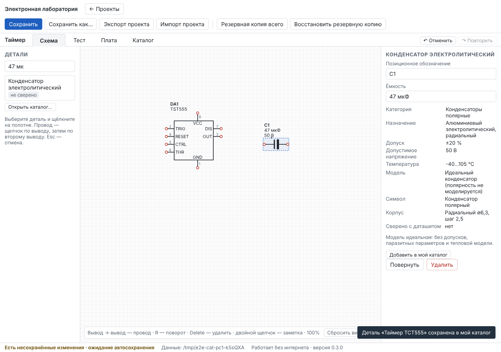

# Отчёт: этап 2 — каталог реальных компонентов

Дата: 11.10.2026 · Версия 0.3.0 · Статус: **реализован, автотесты зелёные на Linux и Windows; ожидает приёмки пользователем.**

Решения этапа описаны в [ADR-0003](../adr/0003-catalog-and-kicad-import.md).

## Реализовано

- **Формат проекта v3** с миграцией v2 → v3 (фикстура и тест): назначение, маркировка, номинал, допуск, пределы, температура, полярность, даташит, источник и лицензия, отметка «сверено» с датой; функции выводов; монтаж, шаг и нумерация корпуса. Старые проекты и личный каталог обновляются автоматически.
- **Экран «Каталог деталей»** — кнопка на начальном экране и вкладка «Каталог» в проекте: поиск по названию, партномеру, маркировке, корпусу и номиналу («47 мк», «10к», «470 В»), категории с количеством, «Все / Встроенные / Мои», карточка: номиналы и пределы, обозначение, корпуса с ключом первого вывода и нумерацией, таблица выводов с площадками выбранного корпуса, модель, источник, лицензия, даташит (открывается в браузере только по нажатию и после вопроса).
- **Встроенный справочник:** типовые резисторы (0,25 Вт, 0805, 2 Вт), конденсаторы (керамические выводной и 0805, электролит 47 мкФ 50 В), дроссель, предохранитель, варистор, штыревые разъёмы, клеммник, кнопка, светодиод, диодный мост; реальные — 1N4007, 1N4148, 1N5819, 1N4733A, BZX55C5V1, BC547, BC557, 2N3904, 2N3906, IRF540N, IRLZ44N, 2N7000, BT151-500R, BT136-600, NE555 (DIP-8 и SOIC-8), LM358, LM317T, L7805CV, 74HC00 (DIP-14 и SOIC-14), ATmega328P. Все реальные помечены «не сверено»; у полупроводников и микросхем модели нет, что видно в списке и карточке.
- **Редактор деталей и микросхем** (новая деталь, новая микросхема с заданным числом выводов, «Создать на основе», «Изменить» своей): основное и номинал с пределами; выводы микросхемы — номер, имя, тип, функция, обозначение строится само (входы слева, выходы справа, питание сверху, земля снизу); корпуса — 17 семейств с параметрами (выводы, шаг, ряды, площадки, отверстия), несколько корпусов на один партномер, для каждого — таблица «вывод → площадка» с подсветкой площадки на рисунке, «Сопоставить по номерам», ключ первого вывода; модель — «нет» или идеальная R/C/L; источник, лицензия, примечания, «Я сверил с даташитом». Проверки видны сразу; ошибки (вывод без площадки, площадка у двух выводов, повтор номеров, дубликат партномера в моём каталоге) не дают сохранить.
- **Импорт из библиотек KiCad:** официальные библиотеки с gitlab.com (только по кнопке, только этот сайт) — единые файлы KiCad 6–8 и библиотеки-папки KiCad 9; или файлы `.kicad_sym` / `.kicad_mod` с компьютера (без интернета). Посадочные места подставляются из символа. Предпросмотр показывает обозначение, корпуса, выводы по каждому корпусу, источник, лицензию и список упрощений. Сохраняется только после проверки в редакторе; дальше деталь доступна без интернета. Перевод: категория и префикс по ГОСТ 2.710, стандартные обозначения перенумерованы по именам выводов KiCad (у BC547 в KiCad 1 = C, 2 = B, 3 = E — так и остаётся), «земля» узнаётся по имени, инверсия `~{RST}` — черта сверху.
- **Схема:** левая панель — поиск по всему каталогу и размещение; на схеме видны номинал, напряжение конденсатора, у полупроводников и микросхем — партномер; в свойствах — сведения о детали, «Сверено с даташитом: нет», предупреждение «Нет SPICE-модели…»; расчёт со схемой без модели останавливается с объяснением; «Добавить в мой каталог» для детали из проекта (например, полученного с другого ПК).
- **Хранилище:** личный каталог в `data/library/catalog.json` — атомарная запись, `.bak`, повреждённый файл не перезаписывается, входит в полный бэкап; деталь в проекте — копия, поэтому `.elab` самодостаточен.

## Проверено

| Набор | Локально | CI Linux | CI Windows |
|---|---|---|---|
| Проверка типов | без ошибок | без ошибок | без ошибок |
| Unit | 91 / 91 | ✓ | ✓ |
| Integration (включая ngspice и каталог) | 34 / 34 | ✓ | ✓ |
| E2E в окне программы | 9 / 9 (+1 портативный — только в CI) | ✓ | ✓ |
| Импорт настоящих файлов KiCad с gitlab.com | недоступно из среды разработки | ✓ | — |

Проверки ТЗ для этапа 2 и где они выполняются:

| Проверка ТЗ | Как проверено |
|---|---|
| Значения и корпуса | Карточка NE555 (корпуса DIP-8 и SOIC-8, выводы, «нет модели»); поиск по «470 В»; электролит «47 мкФ, 50 В» на схеме — e2e |
| Редактор выводов | Микросхема из 8 выводов с именами, типами и функциями; обозначение перестраивается — e2e; изменение пиновки — unit |
| Ключ первого вывода | Квадратная площадка 1 у DIP-8 и TO-92, точка-ключ на рисунке, текст ключа — unit (генераторы, импорт) и e2e |
| Импорт | KiCad Timer → NE555P + DIP-8 + SOIC-8 с источником и лицензией → редактор → каталог — e2e; на настоящих файлах gitlab.com — CI |
| Сохранение и перенос своей детали | Файл каталога после сохранения, перезапуск, `.elab` → другой ПК → деталь в проекте → «Добавить в мой каталог» → «Поставить на схему» — e2e; бэкап с каталогом — integration |
| Характеристики на схеме | Номинал, напряжение, партномер на полотне — e2e |
| Предупреждение «нет модели» | Бейдж в каталоге, предупреждение в свойствах, расчёт останавливается («DA1: нет электрической модели…») — e2e |
| Дубликаты и пиновка | Дубликат партномера, вывод без площадки, площадка у двух выводов, повтор номеров — unit и e2e |

## Что нашли тесты и что исправлено по ходу

1. Импорт настоящих файлов KiCad показал, что официальная библиотека символов перешла на формат KiCad 9 — папки с файлом на символ (`Timer.kicad_symdir/NE555P.kicad_sym`, родитель — в другом файле). Добавлена поддержка; проверено на gitlab.com в CI и на фикстуре локально.
2. Имена выводов в KiCad 9 другие, чем в старых версиях (TRIG/OUT/~{RST}/CONT/THRES/DISCH), и «земля» у них типа `power_in`: GND попадал наверх рядом с VCC. Теперь земля узнаётся по имени, инверсия отображается чертой сверху.
3. Смена категории у детали с корпусами заменяла обозначение — номера выводов могли поменять смысл без предупреждения. Теперь обозначение меняется только у детали без корпусов.
4. Деталь, добавленная в каталог из чужого проекта, при повторном размещении встраивалась второй копией. Теперь каталожный UUID сохраняется, и проект использует уже встроенную копию.
5. Подписи выводов сверху/снизу микросхемы наезжали друг на друга — выводы разнесены по длине имён.

## Ограничения (честно)

- Встроенный справочник и импортированные детали **не сверены**: распиновки взяты из типовых данных, размеры площадок — типовые (близкие к IPC-7351). Перед изготовлением платы сверьте с даташитом своей детали и отметьте «Я сверил».
- Импорт — только из библиотек KiCad. «Поиск по партномеру на сайтах производителей» не сделан: нет открытого источника с понятной лицензией и машиночитаемым форматом (ADR-0003). Описание детали из KiCad короткое (на английском), номиналы и пределы не импортируются — их вносите сами.
- В библиотеках-папках KiCad 9 описание символа видно после выбора (подгружается по одному файлу).
- Многосекционные символы (например, LM358) собираются в один прямоугольник; посадочные места со сложными площадками упрощаются — об этом сказано в предпросмотре.
- SPICE-модели реальных полупроводников и микросхем — этап 4. Сейчас моделируются только идеальные R, C, L и источники.
- Полноценный редактор схемы и ERC — этап 3; корпуса из каталога уже ставятся на плату, но плата по-прежнему односторонняя с прямыми дорожками (этап 6).
- Проверка на ваших ПК: в CI Windows (`windows-latest`) все наборы проходят, но это не ваш компьютер; импорт из интернета на Windows проверен только через тестовые файлы.

## Что дальше

Этап 3 — 2D-редактор схем, граф связности, ERC, экспорт SVG/PNG/PDF — по [плану](../PLAN.md), после вашей приёмки этапа 2.
