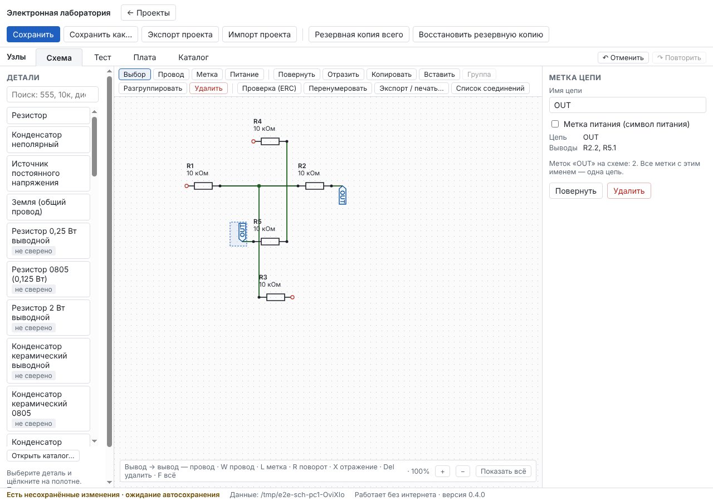
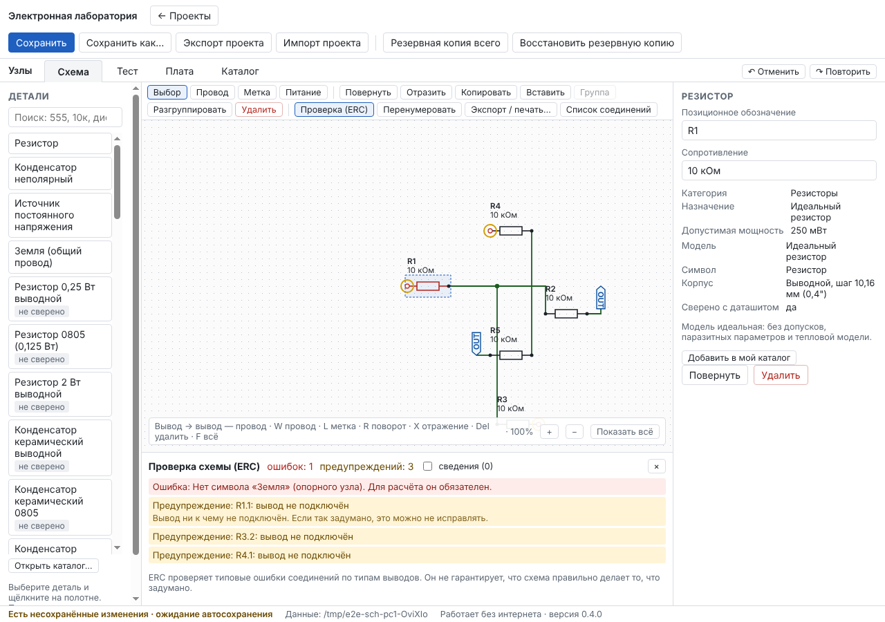
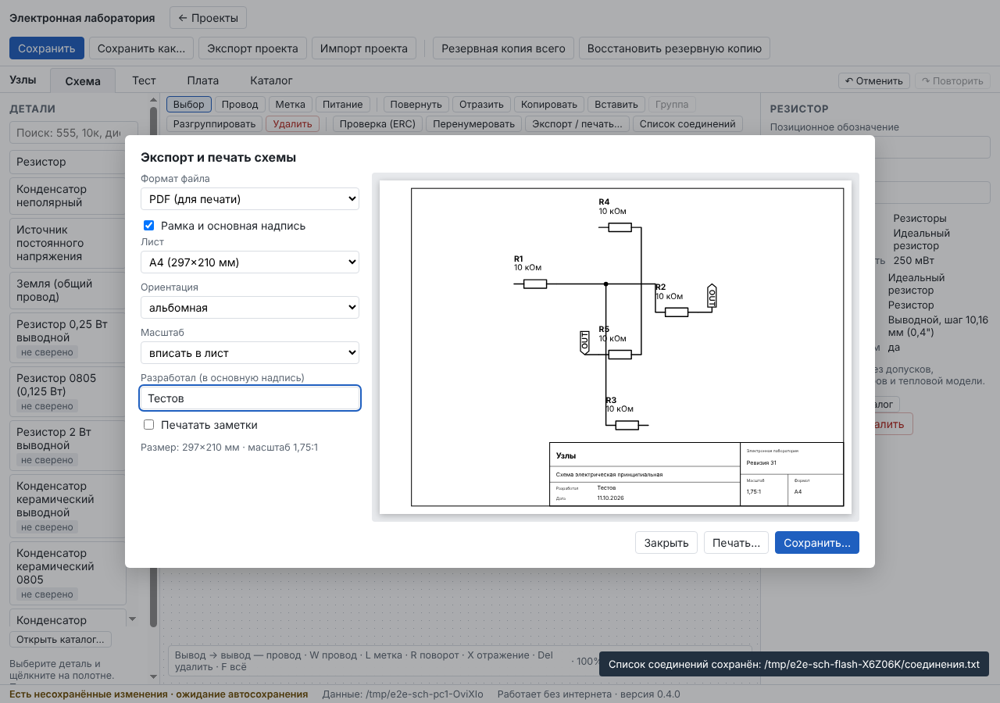

# Отчёт: этап 3 — 2D-редактор принципиальных схем

Дата: 11.10.2026 · Версия 0.4.0 · Статус: **реализован, автотесты зелёные; ожидает приёмки пользователем.**

Решения этапа — в [ADR-0004](../adr/0004-schematic-graph.md).

## Реализовано

- **Связность — граф в документе (формат v4).** Провод соединяет две вершины: вывод, узел, метку цепи или свободный конец. Цепи пересчитываются по графу после каждой правки, их UUID сохраняются (на них опираются плата и расчёт). Пересечение проводов без узла — не соединение; ветвление от середины провода делит его узлом с точкой. Старые проекты обновляются автоматически: связи, державшиеся в v3 не на проводах, сохраняются явными метками.
- **Полотно:** сетка с привязкой, масштаб колесом и кнопками, «Показать всё» (F), панорама правой кнопкой; выделение щелчком, Shift/Ctrl и рамкой; перемещение группой (провода к неподвижным выводам перестраиваются), поворот (R), отражение (X), копирование, вставка, дублирование, вырезание (Ctrl+C/V/D/X), группы (Ctrl+G, Ctrl+Shift+G), удаление (Delete), «выделить всё» (Ctrl+A). Все правки — через Undo/Redo.
- **Провода:** вывод → вывод одним щелчком по каждому; инструмент «Провод» (W) — с изгибами, от середины провода, от узла или метки, со свободным концом (двойной щелчок). Свободные концы помечены на схеме.
- **Метки цепей и питания:** «Метка» (L) и «Питание» (P) — на выводе, на проводе или отдельно; одинаковое имя — одна цепь; метка питания рисуется символом питания и прямо говорит, что напряжения не создаёт. В свойствах метки — переименование, список выводов цепи, число одноимённых меток.
- **Позиционные обозначения:** выдаются автоматически (R1, R2…), переименование с проверкой конфликтов, «Перенумеровать» — по положению (сверху вниз, слева направо) с перечнем изменений; при вставке — свободные номера.
- **ERC** («Проверка (ERC)»): ошибки, предупреждения и сведения; щелчок по замечанию выделяет объекты, переносит к месту и показывает объяснение; на полотне — кружки на местах. Правила перечислены в ADR-0004: нет земли, неподключённые выводы питания и входы, конфликт выходов, питание без источника, питание на земле, разные метки питания в одной цепи, закороченный источник, одни входы в цепи, подключённый NC, висящие провода, одинокие метки, касание без соединения, нет модели. Внизу панели: ERC не гарантирует правильность замысла.
- **Экспорт и печать** («Экспорт / печать…»): PDF, SVG, PNG (100/200/300 точек на дюйм); листы A4, A3, A2, альбомный и книжный; рамка и основная надпись (название, «Схема электрическая принципиальная», разработал, дата, ревизия, масштаб, формат); масштаб «вписать», 1:2, 1:1 (шаг сетки 2,54 мм), 2:1 с предупреждением об обрезке; заметки — по выбору; предпросмотр листа. Печать — системный диалог.
- **Список соединений** — общий интерфейс к расчёту и плате: детали с номиналами и корпусами, цепи с выводами и площадками; сохраняется текстом для сверки.

## Проверено

| Набор | Локально | CI Linux | CI Windows |
|---|---|---|---|
| Проверка типов | без ошибок | без ошибок | без ошибок |
| Unit | 119 / 119 | ✓ | ✓ |
| Integration | 34 / 34 | ✓ | ✓ |
| E2E в окне программы | 10 / 10 (+1 портативный — только в CI); также на экране 1024×768 | ✓ | ✓ |

Проверки ТЗ для этапа 3:

| Проверка ТЗ | Как проверено |
|---|---|
| Цепи с разветвлениями и пересечениями | Ветвление от середины провода — узел, точка, одна цепь; провод наперерез — без точки, цепи разные (e2e и unit) |
| Перемещение детали без потери соединений | Перетаскивание R2: провод следует за выводом, цепи те же; группа, поворот, отражение (e2e и unit) |
| Undo/Redo | Отмена и повтор перемещения; удаление ответвления и отмена — узел возвращается (e2e) |
| Сохранение и перенос | `.elab` → другой ПК: те же провода, узел, метки; список соединений совпадает строка в строку (e2e); миграция v3 → v4 (unit) |
| ERC с местом, объяснением, уровнем | «Нет земли» — ошибка с объяснением, неподключённые выводы — предупреждения, метка места (e2e); все правила — unit |
| Экспорт SVG/PNG/PDF, масштаб, подписи | SVG 297×210 мм с автором; PDF — MediaBox A4 (841,9 × 595,3 пункта); PNG — 1169×827 точек, 100 точек/дюйм записано в файл (e2e); масштаб 1:1 и обрезка (unit) |

## Что нашли тесты и что исправлено по ходу

1. На маленьком экране Windows-раннера панель инструментов в две строки сделала полотно ниже, и сквозной тест прототипа щёлкал по строке состояния — координаты в тесте уложены в низкое полотно, весь набор e2e дополнительно проверен на экране 1024×768.
2. Подсказка внизу полотна перехватывала щелчки по схеме (упали тесты этапа 1) — теперь она «прозрачна» для мыши, кнопки масштаба остаются активными; текст подсказки сокращён, чтобы не закрывать нижнюю часть схемы.

## Ограничения (честно)

- Один лист на проект; иерархических листов и шин нет.
- Ломаную существующего провода нельзя править перетаскиванием отрезка — провод перерисовывается (удалить и провести заново) или перестраивается сам при перемещении деталей.
- Подписи деталей ставятся автоматически рядом с обозначением; ручного перемещения подписи нет.
- Основная надпись упрощённая (по мотивам ГОСТ 2.104), не полная форма 1.
- Печать проверена построением PDF тем же движком; сама отправка на принтер — системный диалог, автотестом не проверяется. Проверьте печать на своём принтере: при масштабе 1:1 шаг сетки должен быть 2,54 мм.
- ERC проверяет соединения по типам выводов; у деталей прототипа и пассивных деталей типы «пассивный», поэтому часть правил срабатывает только на микросхемах.

## Что дальше

Этап 4 — симуляция ngspice: модели диодов, транзисторов, MOSFET и поддерживаемых ИС, анализ AC, параметрические прогоны, контроль пределов — по [плану](../PLAN.md), после вашей приёмки этапа 3.
