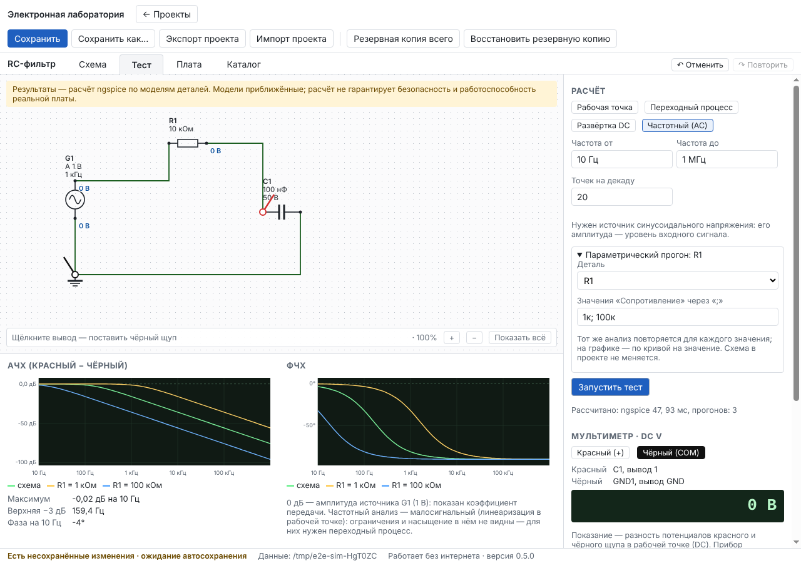
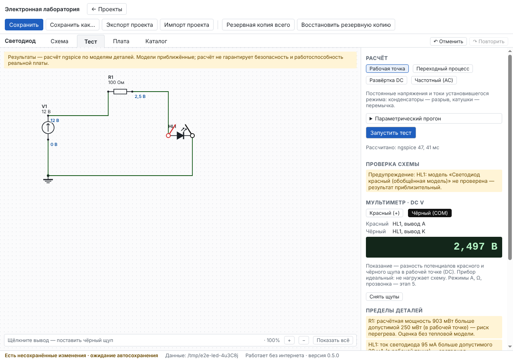
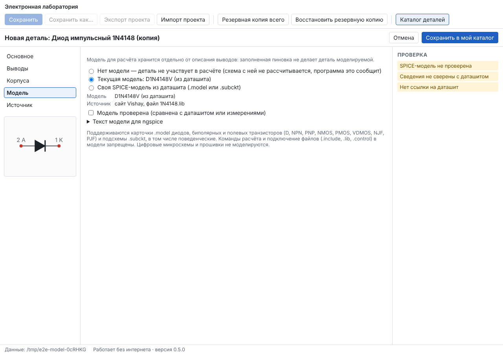

# Отчёт: этап 4 — симуляция

Дата: 11.10.2026 · Версия 0.5.0 · Статус: **принят пользователем.**

Решения этапа — в [ADR-0005](../adr/0005-simulation-models-and-analyses.md).

## Реализовано

- **Модели во встроенном справочнике** (все с источником и отметкой «не проверена»):
  - диоды 1N4007, 1N4148, 1N5819 и транзисторы BC547B, BC557B, 2N3904, 2N3906 — модели производителей;
  - стабилитроны 1N4733A, BZX55C5V1 и красный светодиод — упрощённые модели по даташиту;
  - MOSFET IRF540N, IRLZ44N, 2N7000 — порог, сопротивление открытого канала, ёмкости, встроенный диод;
  - NE555, LM358, L7805, LM317 — поведенческие модели по формулам даташита.
- **Что честно не рассчитывается:** тиристор, симистор, мост, предохранитель, варистор, кнопка. Цифровые микросхемы (74HC00) и микроконтроллер (ATmega328P) тоже: расчёт останавливается с объяснением, что моделирование аналоговое, логика и прошивка не исполняются.
- **Своя модель из даташита.** В редакторе детали, раздел «Модель», можно вставить `.model` (диод, транзистор, MOSFET, JFET) или `.subckt`:
  - выводы модели сопоставляются с выводами обозначения, подсказка — по именам A/K, B/C/E, G/D/S;
  - указывается источник модели, отметка «Модель проверена» ставится вручную;
  - `.include`, `.lib`, `.control`, команды расчёта и `shell` в модели запрещены.

  Деталь, которую раньше поставили в проект без модели, получает её кнопкой «Взять модель из каталога» в свойствах. Сам проект молча не меняется.
- **Анализы** — вкладка «Тест», выбор анализа хранится в проекте:
  - рабочая точка;
  - переходный процесс;
  - развёртка DC по источнику напряжения или тока;
  - частотный анализ: АЧХ в дБ относительно амплитуды источника синуса, ФЧХ, частоты −3 дБ.

  Графики показываются под схемой, во всю ширину. Подписи делений «круглые», у частоты — логарифмическая ось, курсор показывает значения под мышью.
- **Параметрический прогон.** Тот же анализ повторяется для 1–12 значений параметра детали (например, R1 = 1 к; 10 к; 100 к), на графике — по кривой на значение. Схема проекта при этом не меняется.
- **Источники сигналов:** синус (амплитуда, частота, постоянная составляющая), прямоугольные импульсы (уровень, частота, заполнение), постоянный ток.
- **Токи выводов и мощность.** Для каждого вывода прибора виден ток, отдельно — рассеиваемая мощность Σ U·I. Ток выхода стабилизаторов и ОУ в модели берётся из вывода питания, поэтому мощность регулятора считается правильно.
- **Контроль пределов.** Проверяются:
  - мощность резисторов и приборов;
  - напряжение конденсаторов и обратная полярность электролитов;
  - обратное напряжение и ток диодов и светодиодов;
  - Uкэ и Uси, ток коллектора и стока;
  - питание микросхем выше максимума или ниже минимума, ток выхода.

  В каждом предупреждении сказано, где достигнут максимум («в рабочей точке», «при t = …», «при V1 = …»), а в прогоне — при каком значении параметра. Для мощности добавлено: «оценка без тепловой модели».
- **Формат проекта v5** с миграцией v4 → v5: настройки анализов и прогона. Старые проекты открываются с прежними настройками переходного процесса.

## Проверено

| Набор | Локально | CI Linux (ngspice из Ubuntu) | CI Windows (ngspice-47) |
|---|---|---|---|
| Проверка типов | без ошибок | без ошибок | без ошибок |
| Unit | 127 / 127 | ✓ | ✓ |
| Integration, включая 20 новых эталонных расчётов на ngspice | 54 / 54 | ✓ | ✓ |
| E2E в окне программы | 13 / 13 (+1 портативный — только в CI) | ✓ | ✓ |

Эталонные расчёты и их допуски (`tests/integration/sim-models.test.ts`):

| Схема | Ожидание | Допуск |
|---|---|---|
| 5 В → 470 Ом → 1N4007 | U = N·φт·ln(I/IS) + I·RS; 0,6…0,75 В | 0,5 % |
| 12 В → 1 кОм → 1N4733A | 5,1 В по даташиту | 4,85…5,36 В |
| 5 В → 330 Ом → светодиод | 8…10 мА, 1,8…2,2 В | — |
| BC547B, база через 1 МОм | β 200…450 (даташит B-группы), Uбэ 0,55…0,7 В, ΣI = 0 | 1 нА |
| IRF540N, Uзи = 10 В | Rси откр. 44 мОм | 25 % |
| LM358 ×11 | 3,3 В; насыщение 7,5 В; полоса ≈ 1 МГц/11 | 1 %; ±0,1 В; 60…120 кГц |
| NE555, Ra = 1 к, Rb = 10 к, C = 10 нФ | f = 1/(ln2·21 к·10 нФ) = 6,87 кГц; заполнение 11/21 | 3 % |
| L7805, LM317 | 5 В; 1,25·(1 + 720/240) + 50 мкА·720 Ом | 1 %; 0,5 % |
| RC, fc = 1 кГц | 0,707 и −45° | 0,5 %; 1 % |
| RLC 10 мГн / 100 нФ | f0 = 5,03 кГц | 1 % |

## Что нашли тесты и что исправлено по ходу

1. Поведенческая модель NE555 из гладких функций при медленном заряде (большой C) «застревала» у порога: возникало равновесие с частично открытым разрядным ключом. Исправлено двумя мерами. Во-первых, сделан триггер с удержанием состояния, у которого сброс сильнее удержания. Во-вторых, у компараторов появился гистерезис через выход триггера. Генерация проверена при 5, 9, 12 и 15 В и ёмкостях от 1 нФ до 10 мкФ.
2. В частотном анализе ngspice не даёт токи деталей и из-за этого отказывается записывать результат целиком. Теперь записываются только напряжения узлов.
3. Порча байта в середине резервной копии иногда попадала в служебное поле ZIP (время файла), которое на данные не влияет. Тест теперь портит данные файла.

## Ограничения (честно)

- Все модели приборов и микросхем приближённые и помечены «не проверены». Они воспроизводят типовое поведение, а не разброс, температурные зависимости, шумы и пробой конкретного экземпляра. MOSFET — уровень 1 (квадратичная характеристика, без подпорогового режима).
- Поведенческие модели микросхем не воспроизводят ограничение тока, тепловую защиту, смещение нуля, входной диапазон ОУ и задержки. NE555 точен в пределах нескольких процентов до десятков кГц, выше расходится сильнее. Работа NE555 при напряжении ниже минимального не моделируется — об этом есть предупреждение.
- Тепловой модели нет: превышение мощности — предупреждение, а не расчёт температуры.
- Цифровые микросхемы и микроконтроллеры не моделируются (ADR-0005).
- Частотный анализ малосигнальный: насыщение и ограничение в нём не видны, для них нужен переходный процесс.
- Многослойные графики (несколько щупов одновременно), паузы и скорость воспроизведения переходного процесса, а также приборы (амперметр, омметр, осциллограф, ESR, лабораторный БП) — этап 5.

## Что дальше

Этап 5 — виртуальные приборы: мультиметр (V, A последовательно, Ω, прозвонка, диод), осциллограф, ESR-метр, лабораторный блок питания — по [плану](../PLAN.md), после вашей приёмки этапа 4.
