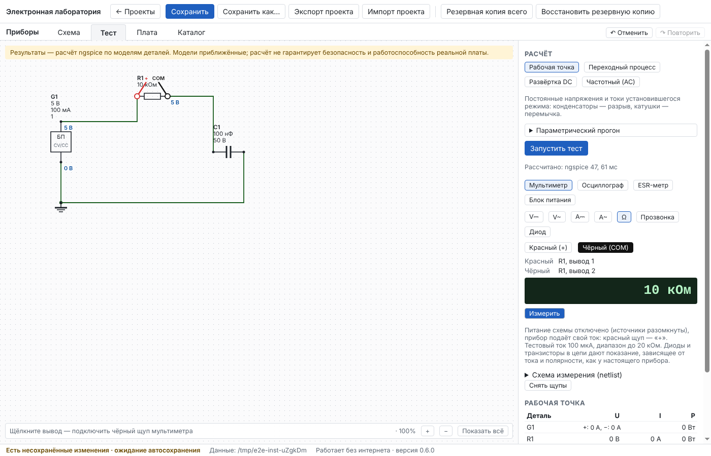
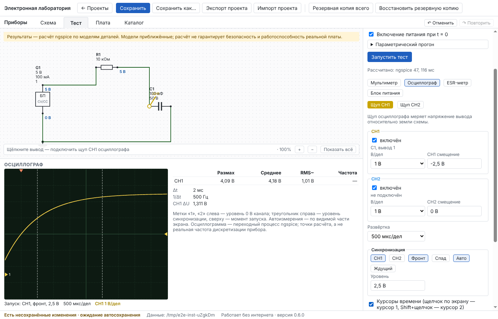
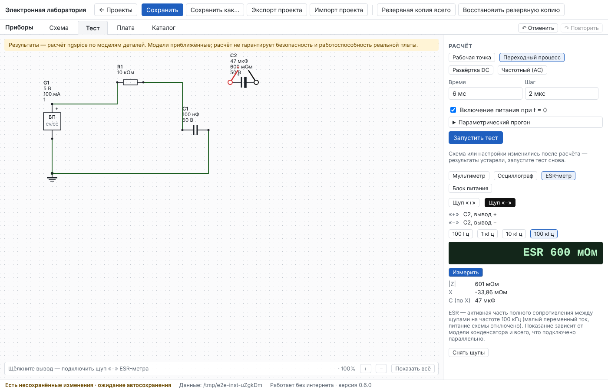

# Отчёт: этап 5 — виртуальные приборы

Дата: 11.10.2026 · Версия 0.6.0 · Статус: **реализован, автотесты зелёные; ожидает приёмки пользователем.**

Решения этапа — в [ADR-0006](../adr/0006-virtual-instruments.md).

## Реализовано

Вкладка «Тест» → блок «Приборы» с четырьмя приборами. Щелчок по выводу на схеме подключает выбранный щуп; на схеме видны метки щупов открытого прибора.

- **Мультиметр** — режимы V⎓, V~, A⎓, A~, Ω, прозвонка, диод.
  - V⎓ и V~ берутся из результата расчёта. В рабочей точке — постоянное напряжение. По переходному процессу — среднее и True RMS переменной составляющей во второй половине записи, с частотой. Под показанием написано, как оно получено.
  - A⎓ и A~: амперметр включается **последовательно** — вывод под красным щупом отсоединяется от своей цепи и подключается через прибор. Показание — ток, втекающий в этот вывод. Выбор режима A меняет схему расчёта, поэтому старые результаты помечаются устаревшими. Ток больше 10 А — предупреждение о предохранителе.
  - Ω, прозвонка, диод — кнопка «Измерить». Питание схемы отключается (источники размыкаются), прибор подаёт свой ток:
    - Ω — пять диапазонов, от 1 мА до 20 МОм, выше — OL;
    - прозвонка — сигнал при сопротивлении меньше 30 Ом;
    - диод — 1 мА, OL выше 3 В.

    Диоды и транзисторы в цепи дают показание, зависящее от тока и полярности, как у настоящего прибора. Щуп можно приложить и к детали, ещё не подключённой к схеме.
- **Осциллограф** работает по переходному процессу:
  - экран 10 × 8 делений, два канала, В/дел и смещение, время/дел (ряд 1-2-5);
  - синхронизация: канал, фронт или спад, уровень, режимы «авто» и «ждущий»;
  - метки уровня 0 В, уровня и момента запуска;
  - курсоры времени: Δt, 1/Δt, ΔU каждого канала;
  - автоизмерения по видимой части: размах, среднее, RMS переменной составляющей, частота.

  Если экран выходит за конец записи, об этом сказано.
- **ESR-метр**: частота 100 Гц, 1 кГц, 10 кГц или 100 кГц; показывает ESR, |Z|, реактивное сопротивление и ёмкость. Показание определяется моделью конденсатора. Электролит в справочнике получил параметр «ESR» (по умолчанию 0,6 Ом), он виден на схеме. У идеального конденсатора ESR = 0.
- **Лабораторный блок питания** — новая деталь справочника («Источники»).
  - Ручки на панели: напряжение, ограничение тока, «Выход: ВКЛ/ВЫКЛ».
  - Индикатор режима: CV, CC или OFF; показания выходного напряжения и тока.
  - Ручки меняют параметры детали, работают Ctrl+Z / Ctrl+Y.
- **Одно согласованное состояние.** Все показания V/A, осциллограмма и блок питания берутся из одного расчёта для текущей схемы. Измерения Ω, прозвонкой, диодом и ESR привязаны к схеме и положению щупов. После любой правки старые числа не показываются.

## Проверено

| Набор | Локально | CI Linux | CI Windows |
|---|---|---|---|
| Проверка типов | без ошибок | см. ниже | см. ниже |
| Unit | 134 / 134 | | |
| Integration (+ 11 расчётов приборов на ngspice) | 65 / 65 | | |
| E2E в окне программы (+ сценарий «Приборы») | 14 / 14 (+1 портативный — только в CI) | | |

Проверки из ТЗ и эталоны (`tests/integration/instruments.test.ts`):

| Проверка ТЗ | Схема | Ожидание | Допуск |
|---|---|---|---|
| Делитель напряжения | 10 В, 10 к / 10 к | V⎓ = 5 В; ток в разрыв ±0,5 мА; напряжения схемы с амперметром те же | 1e-9 |
| Сравнение с эталоном | синус 1 В, делитель 1:2 | V~ = 1/(2√2) = 0,3536 В, 1 кГц | 0,2 % |
| Сопротивление | тот же делитель, источник отключён | 10 кОм; 20 кОм; конденсатор — OL | 1e-6 |
| Диод | 1N4007, светодиод | 0,4…0,7 В и OL в обратном; 1,7…1,9 В | — |
| ESR | электролит 47 мкФ / 0,6 Ом | 0,6 Ом; C = 47 мкФ; на 100 Гц \|X\| = 1/(2πfC) | 1e-6 |
| Источник с ограничением тока | БП 5 В / 0,1 А | 100 Ом — CV, 50 мА; 10 Ом — CC, 0,1 А и 1 В; КЗ — 0,1 А; холостой ход — 5 В; выключен — 0 | 0,1 %; 2e-6 |
| RC-заряд и осциллограмма | БП → 10 к → 100 нФ | запуск 2,5 В при τ·ln 2 = 0,693 мс; Uc(τ) = 63,2 %; ждущий режим без запуска пуст | 1 % |

## Что нашли тесты и что исправлено по ходу

1. Первая модель блока питания — источник тока с насыщением (`min/max`, затем `tanh`) — не сходилась в ngspice. У насыщенного источника производная равна нулю, и метод Ньютона прыгал между 0 и 10 В. Новая модель — источник уставки с выходным сопротивлением 1 мОм и «стенкой» 1 МОм/А сверх ограничения тока. Она кусочно-линейная, с ненулевым наклоном везде, и сходится сразу, включая короткое замыкание.
2. Сглаживание излома в этой модели давало на холостом ходу 5,005 В вместо 5 В. Тест через интерфейс поймал это; сглаживание уменьшено до 1 пА, добавлен тест «холостой ход — ровно уставка».
3. Омметр на детали, не подключённой к схеме, отвечал «вывод ни к чему не подключён», а настоящим прибором такую деталь проверить можно. Теперь в схеме измерения свободные выводы получают свои узлы, и неподключённая «земля» измерению не мешает.
4. В новом проекте выбран переходный процесс, поэтому V⎓ — среднее по второй половине записи: 4,993 В, конденсатор ещё дозаряжается. Это верное показание, его метод написан под индикатором. Тест через интерфейс теперь явно выбирает рабочую точку.

## Ограничения (честно)

- Приборы идеальные: вольтметр и осциллограф не нагружают схему, у амперметра сопротивление 0. Входное сопротивление 10 МОм, щупы ×10 и полоса осциллографа не моделируются.
- V~ и A~ считаются по переходному процессу. Окно — вторая половина записи; если там меньше двух периодов, частота не определяется, о чём сказано на индикаторе.
- Осциллограф показывает точки расчёта ngspice, а не дискретизацию реального прибора. Режима «однократный запуск», математики каналов и FFT нет.
- Ω, прозвонка и диод — статические измерения в рабочей точке тестового тока. Время заряда больших ёмкостей щупами не моделируется.
- ESR-метр показывает то, что заложено в модель: у электролита справочника ESR не зависит от частоты, ESL и утечки нет. У идеального конденсатора ESR = 0.
- Блок питания идеализирован: нет переходного процесса самого блока, пульсаций и выброса при включении.
- Формат проекта не менялся (v5): настройки приборов хранятся в поле `instruments.settings`, которое было с первой версии.
- Браузерная демо-версия по-прежнему ничего не рассчитывает. Приборы там показывают «нет расчёта», а кнопка «Измерить» объясняет, что ngspice работает только в программе для ПК.

## Что дальше

Этап 6 — печатная плата: односторонняя и двухсторонняя, DRC, печать 1:1 для ЛУТ, Gerber/Excellon — по [плану](../PLAN.md), после вашей приёмки этапа 5.
