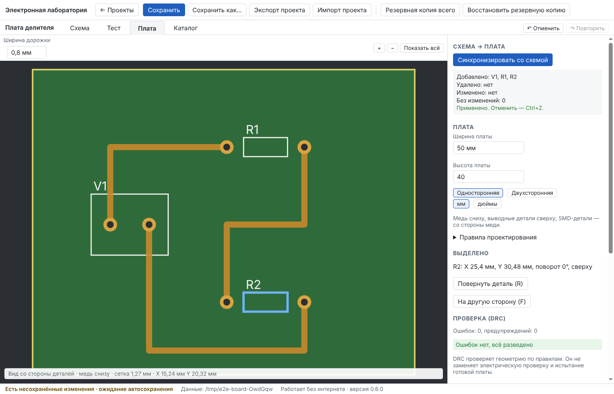
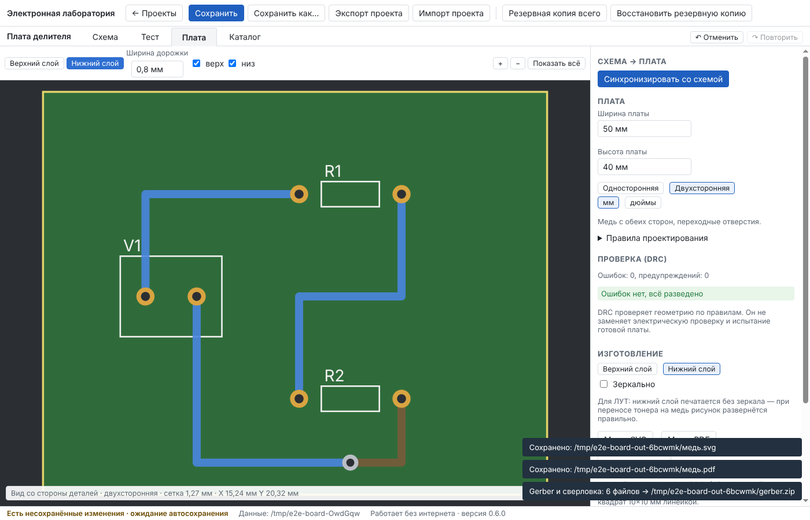
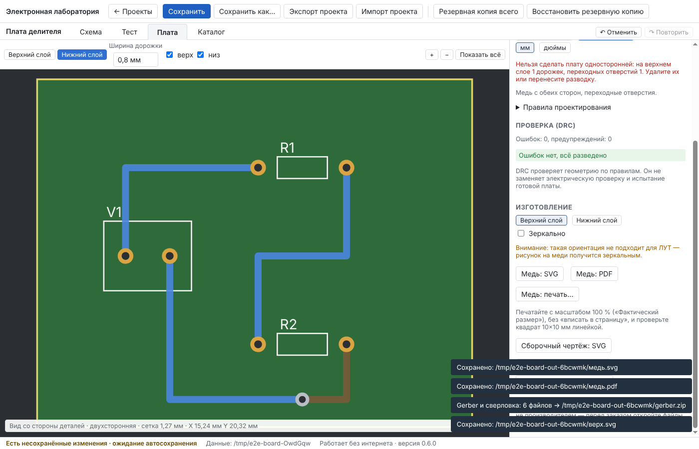

# Отчёт: этап 6 — печатная плата

Дата: 11.10.2026 · Версия 0.7.0 · Статус: **принят пользователем.**

Решения этапа — в [ADR-0007](../adr/0007-pcb.md).

## Реализовано

- **Плата.** Задаются ширина и высота, единицы (мм или дюймы — только отображение и ввод), тип платы: односторонняя (медь снизу, выводные детали сверху) или двухсторонняя. Правила проектирования:
  - ширина новой дорожки и минимальная ширина;
  - зазор и отступ от края;
  - сверло и площадка переходного отверстия;
  - минимальное сверло и поясок меди.

  По умолчанию правила подобраны для ЛУТ: дорожка 0,8 мм, зазор 0,4 мм.
- **Синхронизация со схемой** — сначала отчёт, потом кнопка «Применить» (Ctrl+Z отменяет). Отчёт показывает:
  - что добавлено — новые детали ставятся на свободное место платы;
  - что удалено и сколько дорожек уходит вместе с удалёнными деталями;
  - что изменено — при смене корпуса место и поворот сохраняются;
  - проблемы: вывод, подключённый на схеме, но не сопоставленный площадке; дорожки, которые после правки схемы соединяют разные цепи.

  «Чужие» дорожки не удаляются — их показывают отчёт и DRC.
- **Расстановка.** Детали перетаскиваются, R — поворот, F — на другую сторону платы. SMD-детали на односторонней плате ставятся со стороны меди и видны зеркально.
- **Ручная разводка.**
  - Щелчок по площадке начинает дорожку, щелчки по полю ставят изгибы, щелчок по площадке той же цепи завершает её.
  - Backspace убирает последний изгиб, Esc отменяет дорожку.
  - Дорожку между разными цепями программа не даёт провести и называет обе цепи.
  - Пока ведётся дорожка, площадки её цепи и неразведённые соединения подсвечиваются.
  - На двухсторонней плате клавиша V (или кнопка «Переход») ставит переходное отверстие и переключает слой. Переход можно выделить, удалить вместе с его дорожками и вести от него новую дорожку.
  - У выделенной дорожки можно поменять ширину или удалить её.
- **DRC.** Расстояния считаются по настоящей форме площадок (круг, овал, прямоугольник) и дорожек. Проверяются:
  - зазоры между медью разных цепей и касания — сообщение «Короткое замыкание»;
  - край платы, ширина дорожек, сверло, поясок меди, расстояние между отверстиями;
  - слои: SMD на стороне без меди, верхний слой на односторонней плате;
  - удалённые из схемы детали, перекрытие корпусов;
  - неразведённые цепи, по именам.

  Щелчок по замечанию показывает место на плате.
- **Изготовление дома.**
  - Рисунок меди слоя сохраняется в SVG и PDF или печатается, масштаб 1:1.
  - Программа сама выбирает зеркало для ЛУТ: нижний слой — без зеркала, верхний — зеркально. Если поставить другое, она предупреждает: «не подходит для ЛУТ».
  - На листе — квадрат 10 × 10 мм для проверки масштаба линейкой, керны в центрах отверстий и подпись: какой слой и для чего.
  - Отдельно — сборочный чертёж с позиционными обозначениями.
- **Gerber и Excellon** сохраняются архивом `.zip`: медь, маска, шелкография (контуры корпусов), контур платы, сверловка и readme. Если в DRC есть ошибки, программа перед сохранением спрашивает подтверждение. Экспорт проверен независимым читателем, но не производителем — это написано и в интерфейсе, и в readme.
- **Формат проекта v6** с миграцией v5 → v6. Прежние проекты открываются с той же разводкой.

## Проверено

| Набор | Локально | CI Linux (ngspice из Ubuntu) | CI Windows (ngspice-47) |
|---|---|---|---|
| Проверка типов | без ошибок | без ошибок | без ошибок |
| Unit (+ 18 по плате) | 144 / 144 | ✓ | ✓ |
| Integration (+ 5: Gerber и Excellon независимым читателем) | 70 / 70 | ✓ | ✓ |
| E2E в окне программы (+ сценарий «Плата») | 15 / 15 (+1 портативный — только в CI) | ✓ | ✓ |

Проверки из ТЗ:

| Проверка | Как | Результат |
|---|---|---|
| Масштаб | SVG платы 50 × 40 мм — лист 75 × 58 мм, контур 50 × 40; PDF — MediaBox 212,6 × 164,4 пункта; Gerber — контур 0…50 × 0…40 мм | совпадает до 0,001 мм / 1,5 пункта |
| Расстояния | Две дорожки по 0,8 мм: зазор 0,3 мм — ошибка «Зазор 0,3 мм < 0,4 мм», 0,5 мм — нет; на разных слоях — нет; касание — «Короткое замыкание» | точные числа |
| Отверстия | Excellon: число и координаты отверстий, диаметры = отверстия площадок и переходов; DRC: сверло меньше минимального, тонкий поясок | совпадает |
| Соответствие сетей | Медь из Gerber растеризуется с шагом 0,02 мм, связные области (с учётом металлизированных отверстий) сравниваются с цепями схемы: одна цепь — одна область, разные — не касаются; неразведённая цепь разорвана; GND двухсторонней платы собрана через переход и распадается без него; короткое замыкание видно и в DRC, и в Gerber | совпадает |

## Что нашли тесты и что исправлено по ходу

1. Сначала я хотел сверять Gerber сторонним npm-пакетом. Пакетный реестр здесь закрыт политикой доступа, поэтому проверка написана как независимый читатель по спецификации формата: он не использует код экспорта и проверяет связность меди растром, а не текст файлов.
2. После синхронизации полотно вписывается в окно, поэтому масштаб больше не равен 9 пикселям на мм. Тест через интерфейс теперь берёт масштаб с полотна, а не считает его постоянным.
3. Первая версия не сбрасывала начатую дорожку после ошибки «разные цепи». Следующий щелчок по площадке пытался её закончить. Теперь ошибочная трасса отменяется, а сообщение остаётся.

## Ограничения (честно)

- **Медных заливок нет** (в ТЗ — «по мере реализации»). Нет автотрассировщика, дуг, скруглений, термобарьеров, вырезов и плат непрямоугольной формы.
- Текста в меди и шелкографии нет. Позиционные обозначения есть только на сборочном чертеже; в Gerber-шелкографии — только контуры корпусов.
- Перемычки на односторонней плате пока не поддерживаются — разводите без них или делайте плату двухсторонней.
- Gerber проверен автотестами, но не производителем и не сторонним просмотрщиком. Перед заказом откройте архив в просмотрщике Gerber.
- Деталь, которая не поместилась на плате при синхронизации, ставится под платой с отметкой в отчёте. Расстановка простая, «рядами».
- DRC проверяет геометрию по правилам. Он не заменяет электрической проверки готовой платы и её испытаний.
- Браузерная демо-версия плату показывает и разводит, но не сохраняет файлы.

## Что дальше

Этап 7 — журнал испытаний: измерения на реальной плате, сравнение с расчётом, отказы деталей, ревизии и откат — по [плану](../PLAN.md), после вашей приёмки этапа 6.
