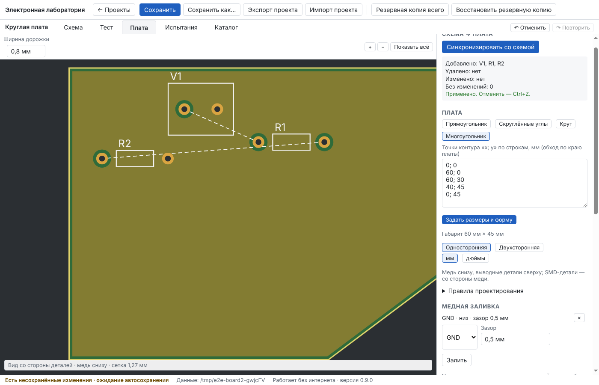

# Отчёт: доработки после этапа 7

Дата: 12.10.2026 · Версия 0.9.0 · Статус: **реализованы, автотесты зелёные локально и в CI на Linux и Windows; ожидают приёмки пользователем.**

Решения — в [ADR-0009](../adr/0009-board-outline-pour-examples.md).

## Реализовано

- **Плата любой формы и размера.**
  - Окно «Новая плата»: габарит от 1 до 2000 мм, ввод в мм или дюймах.
  - Слои: односторонняя или двухсторонняя.
  - Форма: прямоугольник, скруглённые углы (радиус), круг (диаметр), многоугольник по точкам «x; y».
  - Самопересекающийся контур не принимается, причина названа.
  - У готовой платы форма и размеры меняются кнопкой «Задать размеры и форму». Многоугольник при этом масштабируется.
  - DRC, расстановка деталей, печать 1:1, PDF и Gerber (Edge_Cuts) идут по контуру.
- **Медная заливка.** Цепь (обычно GND), слой, зазор:
  - вырезы вокруг чужой меди с заданным зазором;
  - отступ от края платы;
  - площадки своей цепи соединяются заливкой, и неразведённые соединения это учитывают;
  - острова без своей меди — предупреждение DRC;
  - заливка выводится в Gerber (область и вырезы), в печать для ЛУТ и в PDF.
- **Изменение детали в проекте:** характеристики, модель, корпуса, выводы. Общий каталог не меняется. Нельзя убрать вывод, к которому подведён провод, и корпус, стоящий на плате. Правку отменяет Ctrl+Z.
- **Журнал изменений** теперь записывает: смену номинала («R2: сопротивление 10 кОм → 4,7 кОм»), изменение детали, формы платы, заливку, синхронизацию платы, записи испытаний, возврат ревизии.
- **Примеры** на стартовом экране, кнопка «Открыть копию»: светодиод, RC-фильтр, мультивибратор на NE555 с заливкой GND, стабилизатор LM317 на плате со скруглёнными углами, заметки. Пример открывается копией, сам файл примера не меняется.
- **Исправлено:**
  - сообщение об ошибке на вкладке «Плата» больше не остаётся после следующей правки;
  - две кнопки «Применить» на вкладке «Плата» путались — кнопка формы теперь называется «Задать размеры и форму»;
  - автотесты теперь падают при любой ошибке в консоли окна. Прогон всех сценариев с этой проверкой ошибок не нашёл.
- **Формат проекта v8** с миграцией v7 → v8: контур прямоугольный, заливок нет, всё прочее без изменений.

## Проверено

| Набор | Локально (CI Linux и Windows — зелёные) |
|---|---|
| Проверка типов (offline и core) | без ошибок |
| Unit | 158 пройдено, 0 ошибок |
| Integration (ngspice, файлы, Gerber) | 81 пройдено, 0 ошибок |
| E2E (Electron, Playwright) | 18 пройдено, 1 пропущен (портативный `.exe` — только Windows) |

Примеры проверены расчётом ngspice:
- светодиод: ток 14–16 мА;
- RC-фильтр: АЧХ совпадает с формулой во всех точках;
- NE555: 6,9 кГц ± 5 %;
- LM317: 5,04 В.

В CI на Windows первый прогон упал: на маленьком экране раннера деталь у края платы частично уходила за край окна, и тест не мог её взять. Исправлено:
- после синхронизации вид платы снова вписывается в окно;
- тесты берут деталь за видимую часть корпуса.

## Ограничения (честно)

- Нет термобарьеров: площадки соединяются с заливкой сплошь, крупные площадки греются при пайке дольше.
- Связность заливки считается по растру с шагом 0,1 мм (на очень больших платах крупнее). На перешейках такой ширины решение «соединено / остров» приближённое. Сама медь в Gerber и печати — точная.
- Одна заливка на слой; нет вырезов внутри платы.
- В примерах NE555 и LM317 плата расставлена и залита, но разведена не полностью. Неразведённые соединения видны в DRC — это задание для пользователя, а не скрытая ошибка.
