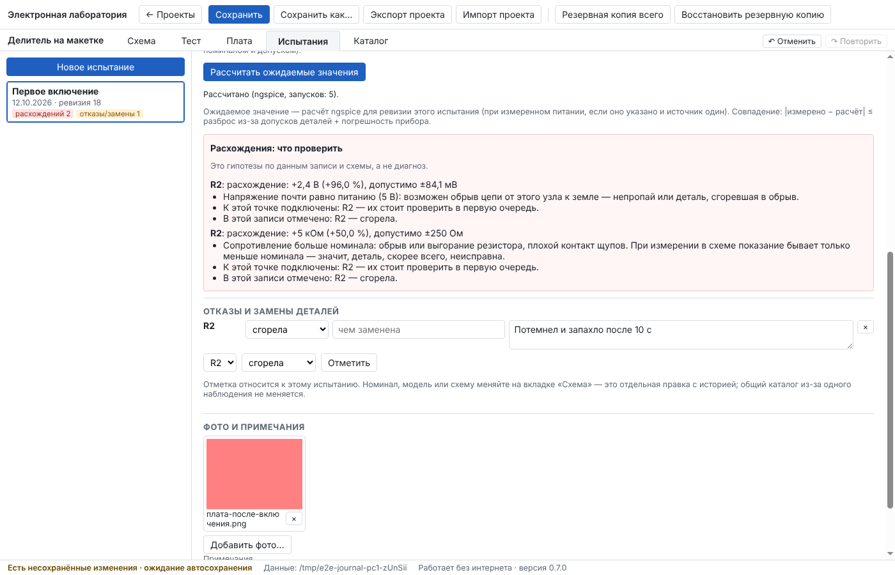
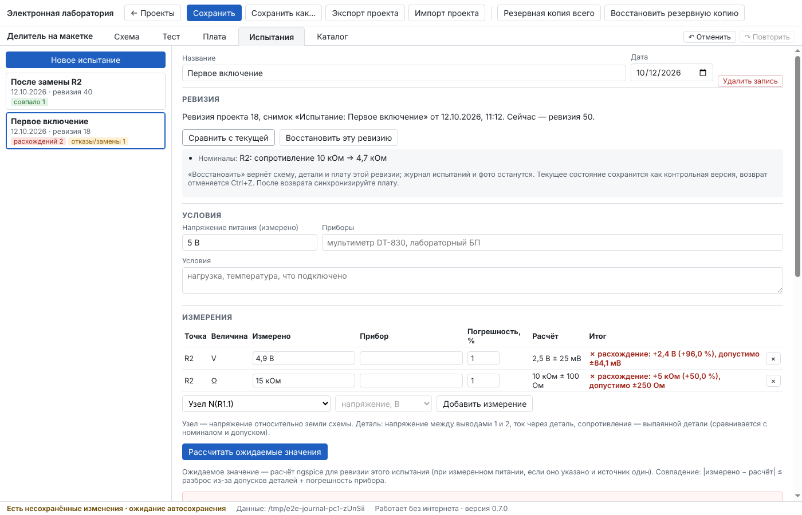

# Отчёт: этап 7 — журнал испытаний

Дата: 12.10.2026 · Версия 0.8.0 · Статус: **реализован, автотесты зелёные; ожидает приёмки пользователем.**

Решения этапа — в [ADR-0008](../adr/0008-test-journal.md).

## Реализовано

- **Вкладка «Испытания».** Новая запись сохраняет снимок ревизии проекта (схема, детали, плата). В записи:
  - название и дата;
  - измеренное напряжение питания, приборы, условия, примечания;
  - фото (копируются в проект и переносятся с ним).
- **Измерения:**
  - в узле — напряжение относительно земли;
  - на детали — напряжение между выводами, ток через деталь, сопротивление выпаянной детали;
  - в точке, описанной словами.

  Кнопка «Рассчитать ожидаемые значения» считает схему этой ревизии в ngspice, при измеренном питании. Разброс считается по допускам резисторов (наихудший случай), а сопротивление сравнивается с номиналом и допуском. Итог — «в пределах допуска» или «расхождение» с отклонением в единицах и процентах и допустимым значением (разброс + погрешность прибора). Если величину посчитать нельзя, значение не выдумывается, а причина названа.
- **Расхождения: что проверить.** Гипотезы строятся только из фактов записи и схемы:
  - напряжение почти нулевое или почти равно питанию — обрыв или замыкание;
  - какие детали подключены к точке;
  - какие отмечены сгоревшими;
  - чьи модели не проверены;
  - отличается ли измеренное питание от схемного.

  У каждой гипотезы пометка: «гипотезы, а не диагноз».
- **Отказы и замены деталей:** «сгорела», «неисправна», «заменена», «снята», чем заменена, обстоятельства.
- **Сравнение ревизий:** что изменилось между ревизией испытания и текущей — детали, номиналы, сведения и модели деталей, соединения, плата, настройки расчёта.
- **Восстановить ревизию:** схема, детали и плата возвращаются к снимку, а **журнал испытаний и фото остаются**. Текущее состояние сохраняется контрольной версией, возврат отменяется Ctrl+Z. Это правило теперь действует и для обычных контрольных версий: раньше возврат заменял документ целиком и стёр бы записи, сделанные после снимка.
- **Каталог не меняется по наблюдению.** Номиналы и модели правятся в проекте. «Добавить в мой каталог» теперь спрашивает подтверждение. Если деталь в каталоге уже есть, сохраняется новая, а прежняя не меняется.
- **Перенос.** Записи, снимки ревизий и фото входят в `.elab` и полный бэкап. При импорте копией, «Сохранить как» и дублировании ссылки записей на снимки сохраняются (раньше копия проекта теряла контрольные версии).
- **Формат проекта v7** с миграцией v6 → v7. Прежние записи сохраняются: точка становится описанием словами.

## Проверено

| Набор | Локально | CI Linux | CI Windows |
|---|---|---|---|
| Проверка типов | без ошибок | | |
| Unit (+ 9 по журналу) | 153 / 153 | | |
| Integration (+ 5: расчёт по допускам на ngspice, хранилище) | 75 / 75 | | |
| E2E в окне программы (+ сценарий «Журнал испытаний») | 16 / 16 (+1 портативный — только в CI) | | |

Проверки из ТЗ (`tests/e2e/journal.spec.ts`, всё через интерфейс). Делитель 5 В на двух резисторах 10 кОм ± 1 %:

| Шаг | Результат |
|---|---|
| Зафиксировать отказ | На R2 измерено 4,9 В и 15 кОм; R2 отмечен «сгорела», обстоятельства записаны |
| Сравнить с расчётом | 2,5 В ± 25 мВ (по 12,5 мВ от каждого резистора), 10 кОм ± 100 Ом — расхождения; гипотеза «обрыв к земле — деталь, сгоревшая в обрыв» |
| Изменить номинал | R2 = 4,7 кОм |
| Синхронизировать плату | «Плата соответствует схеме» — номинал корпус не меняет |
| Пересчитать | Второе испытание: измерено 1,6 В, расчёт 1,599 В — «в пределах допуска» |
| Сравнить ревизии | «R2: сопротивление 10 кОм → 4,7 кОм» |
| Восстановить старую | R2 снова 10 кОм, обе записи журнала на месте |
| Перенос | `.elab` на другом ПК: записи, отметка, фото, сравнение ревизий |

Разброс по допускам сверен с формулой (`tests/integration/journal.test.ts`): делитель 10 к / 4,7 к при 1 % — совпадение до 1e-9.

## Что нашли тесты и что исправлено по ходу

1. Возврат контрольной версии заменял документ целиком, а значит стёр бы записи испытаний, сделанных после снимка. Теперь возврат берёт из снимка только схему, детали и плату (решение — в ADR-0008).
2. Импорт копией выдавал контрольным версиям новые id, а «Сохранить как» и дублирование не копировали их совсем. Записи журнала потеряли бы связь со своими ревизиями. Теперь снимки копируются, а ссылки переназначаются в той же таблице, что и остальные UUID.
3. Дата испытания, записанная около полуночи, в поле показывалась вчерашней (время UTC). Теперь дата хранится как календарный день.
4. У простого «Резистора» из быстрой панели допуск не задан, поэтому расчёт честно показывает «± 0» и пишет «допуски деталей не указаны». В сценарии теста использованы резисторы справочника с допуском ±1 %.

## Ограничения (честно)

- Разброс учитывает только допуски сопротивлений, в линейном приближении наихудшего случая. Допуски источников, ёмкостей, разброс параметров транзисторов и диодов и температура не учитываются — это написано у каждого расчётного значения.
- Сравнение — только для постоянного режима (рабочая точка). Переменное напряжение, частоту и форму сигнала с расчётом автоматически не сравнить: их можно записать как «другое».
- Гипотезы — простые правила по фактам, а не диагностика. Неисправность они не устанавливают.
- Фото — только изображения до 25 МБ. Видео и PDF-файлы не прикладываются.
- Браузерная демо-версия журнал показывает, но не считает ожидаемые значения и не хранит фото.

## Что дальше

Это последний этап плана. После вашей приёмки можно пройти итоговые критерии ТЗ (раздел 11) на ваших компьютерах с флешкой.
