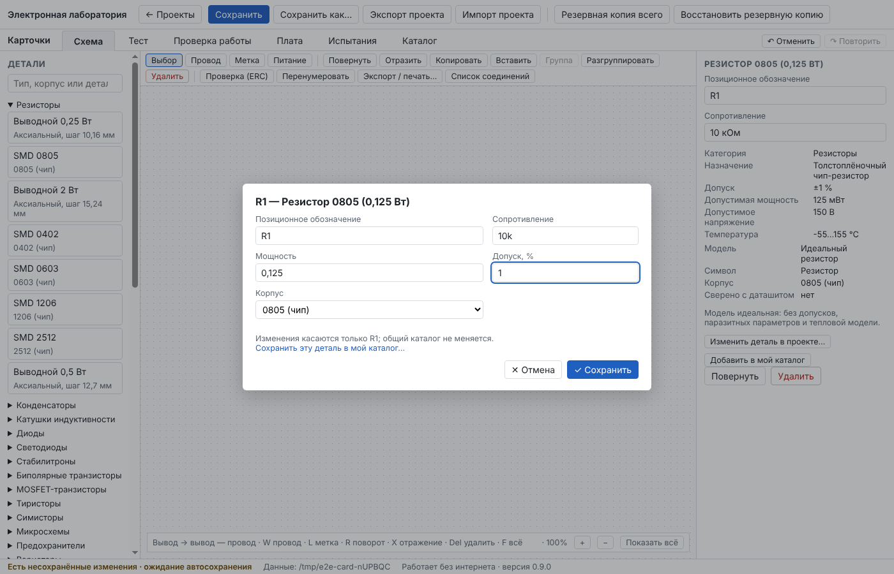
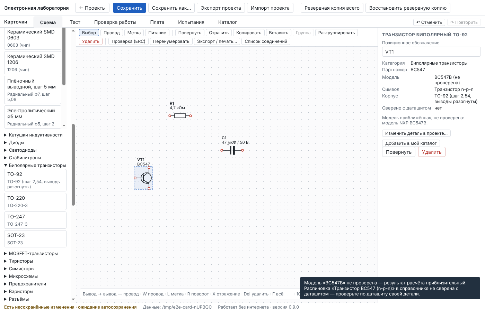
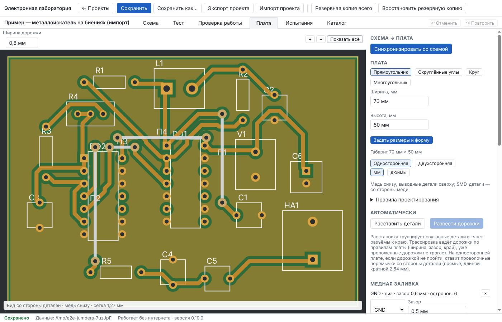
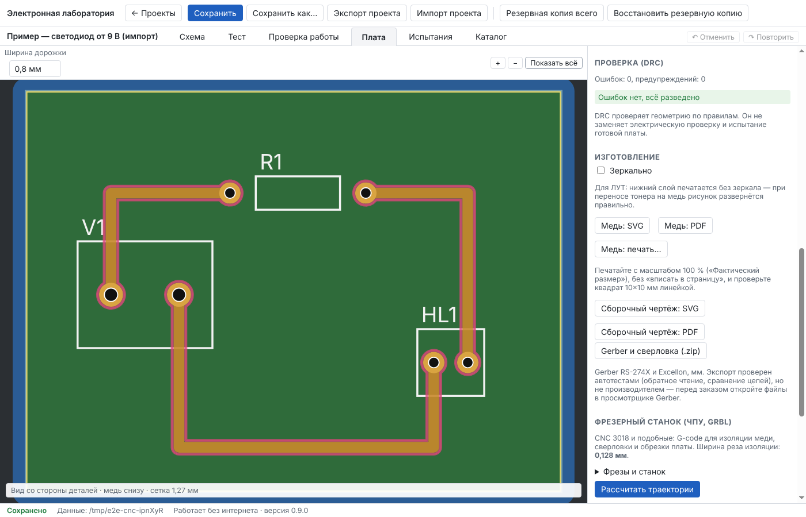
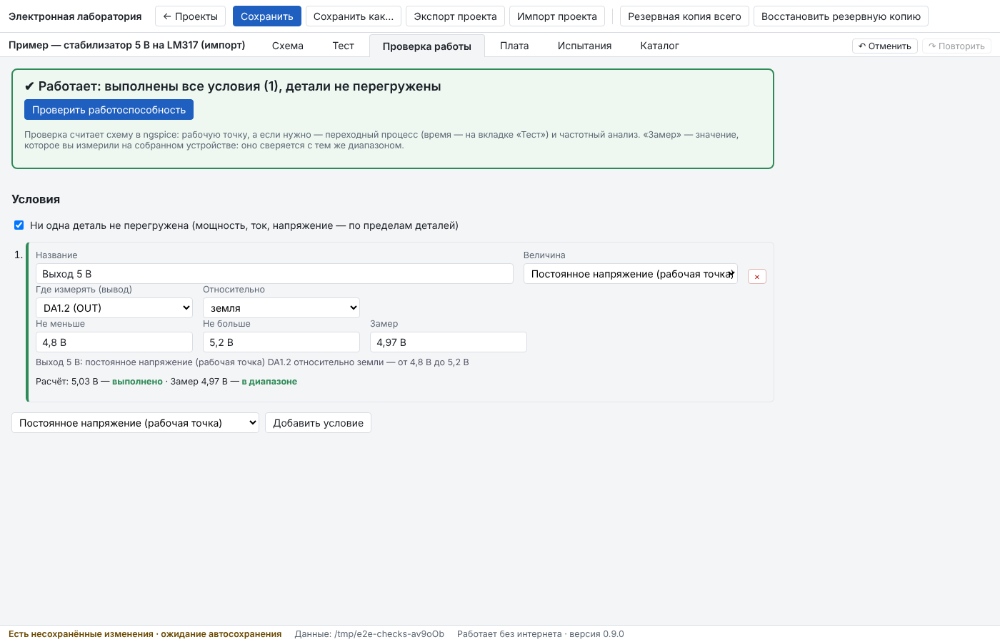

# Отчёт: этап 8 и ТЗ «новый принцип каталога»

Дата: 16.10.2026 · Версия 0.12.1 · Статус: **реализовано, автотесты зелёные; ожидает приёмки.**

Решения — [ADR-0010](../adr/0010-type-package-templates-and-instance-card.md) (карточка детали), [ADR-0011](../adr/0011-jumpers-single-sided.md) (перемычки) и комментарии модулей `cnc.ts`, `autoroute.ts`, `checks.ts`.

## ТЗ «новый принцип каталога» (основное)

Сценарий из ТЗ работает так: левая панель «Детали» → тип (Резисторы, Конденсаторы, …) → корпус (SMD 0805, TO-220, DIP-8…) → деталь рисуется под курсором → щелчок ставит её с новым обозначением (R1, C1, VT1…) → двойной щелчок по детали → карточка → «✓ Сохранить» (Enter) или «✕ Отмена» (Esc).

- **Быстрый поиск по корпусу** — то же поле поиска: «0805», «TO-220», «SOIC» сразу раскрывают подходящие типы. Готовые детали справочника (NE555, BC547…) ищутся там же.
- **Карточка** (по категориям):
  - резистор — сопротивление, мощность, допуск, корпус;
  - конденсатор — ёмкость, рабочее напряжение, допуск, тип, корпус;
  - катушка — индуктивность, допустимый ток, сопротивление обмотки (переключает модель на «L + R»);
  - диоды, транзисторы, тиристоры — наименование, модель (партномер), маркировка, пределы, тип (n-p-n / p-n-p, n- / p-канальный), электрическая модель из справочника, назначение выводов;
  - микросхемы — название, маркировка, корпус; назначение многих выводов и модель — кнопкой «Выводы и модель…» в имеющийся редактор детали.
- **Ввод значений**: «10 Ом, 4,7 кОм, 4k7, 10k, 1M, 4700, 47 мкФ, 47uF, 100nF, 220pF». Неверное — сообщение с примерами, карточка не закрывается.
- **На схеме** — «R1 / 10 кОм», «C1 / 47 мкФ / 50 В», «VT1 / BC547»; подписи двигаются вместе с деталью, сохраняются, печатаются.
- **Только выбранная деталь**: номинал хранится у экземпляра; если меняются мощность, модель, корпус или выводы детали, которой пользуются и другие, она ответвляется. Общий каталог не меняется; «Сохранить эту деталь в мой каталог…» — отдельно, с подтверждением.
- **Честность**: у шаблона транзистора в TO-92 / TO-220 / TO-247 / SOT-23 выводы не назначены. Карточка и DRC платы об этом говорят. По маркировке («BC547») можно взять модель и выводы из справочника — с предупреждением, что распиновка справочника не сверена. Без модели расчёт отказывает с объяснением.
- **Плата**: номинал не меняет корпус; смена корпуса или выводов у детали на плате — предупреждение, изменения приходят через синхронизацию с отчётом.
- **Найдено и исправлено попутно**:
  - корпуса QFP/QFN с большим числом выводов: площадки в углах сливались;
  - TO-92 с шагом 1,27 мм: площадки соседних выводов перекрывались. Теперь узкие овальные площадки, а встроенные транзисторы — с шагом 2,54 мм, «выводы разогнуты».

## Перемычки на односторонней плате (13.10.2026)

- **Автотрассировка**: сначала пробует без перемычек. Если на односторонней плате что-то не развелось — ставит проволочные перемычки со стороны деталей:
  - прямые, по горизонтали или вертикали;
  - длиной кратной 2,54 мм, от 2,54 до 25 мм;
  - провод не ближе 0,5 мм к выводам деталей других цепей и к другим перемычкам;
  - отверстия не под корпусами.
- **Вручную**: при прокладке дорожки J (или кнопка «Перемычка (J)») ставит первое отверстие, щелчок — второе, дальше снова дорожка.
- **На плате и в файлах**:
  - на плате перемычка — светлая линия «П1, П2…»; выделение отверстия показывает длину; удаление одного отверстия убирает перемычку целиком;
  - сборочный чертёж — «П1 17,78 мм»;
  - Gerber — отверстия в сверловке, площадки снизу, маска над ними открыта, линия на шелкографии;
  - станок — отверстия сверлятся вместе с остальными, в ПРОЧТИ.txt — список перемычек с длинами и координатами.
- **Проверка платы (DRC)** — ошибки:
  - перемычка короче 2,54 мм;
  - перемычки разных цепей пересекаются;
  - провод проходит над выводом другой цепи.
  
  Предупреждение — отверстие под корпусом.
- **Пример «Металлоискатель на биениях»** (6-й пример) — схема:
  - поисковый генератор на CD4069 с выносной катушкой 1 мГн;
  - опорный — на CD4093 с подстройкой R4;
  - смеситель, фильтр, пьезоизлучатель.
  
  Плата 70 × 50 мм, односторонняя: разведена автоматически, 3 перемычки, земля залита, DRC без ошибок и без предупреждений. На 60 × 45 мм тоже помещается (авторасстановка плотнее), но тогда нужно 6 перемычек. Условия проверки работы (выполнены в ngspice):
  - оба генератора 140…165 кГц — по расчёту 150,6 и 148,1 кГц, биения около 2,5 кГц;
  - размах биений на излучателе больше 1 В — 2,2 В;
  - ток покоя не больше 5 мА — 1,8 мкА.
- **Формат проекта v10** (список перемычек). Старые проекты открываются миграцией.
- **Найдено и исправлено попутно**:
  - расчёт схем с логикой КМОП (поведенческие модели) мог «застрять» на мелком шаге. Для таких схем теперь метод интегрирования Гира: переходный процесс металлоискателя — секунды вместо 2+ минут;
  - сообщение автотрассировки «Разведено N из M» исчезало сразу после правки. Теперь оно остаётся и считает только действительно недостающие соединения (с учётом заливки);
  - авторасстановка удаляет переходы и перемычки, к которым больше не подходят дорожки.

## Доработки после перемычек (13.10.2026, версия 0.12.0)

- **Автотрассировка в фоне.** Идёт в отдельном потоке:
  - окно отвечает, можно переходить по вкладкам;
  - виден ход: «Попытка 2 из 4 · 12 с»;
  - кнопка «Остановить»;
  - если плату или схему изменили во время трассировки — результат не применяется, программа так и пишет;
  - в браузерной демо-версии — по-прежнему в окне.
- **Острова заливки удаляются** (медь, не соединённая со своей цепью):
  - в Gerber — вырезом;
  - на печати 1:1, у станка и на полотне — тоже нет;
  - в списке заливок — «островов удалено: N»;
  - DRC предупреждает только о заливке, которая не касается своей цепи вовсе.
- **Авторасстановка плотнее, если не помещается.** Повторяет с уменьшенными полями вокруг деталей (до 1/4). Металлоискатель теперь помещается и на 60 × 45 мм.
- **Узкие места.** Что не развелось обычной дорожкой — ведётся ещё раз дорожкой минимальной ширины из правил.
- **Кнопки правил платы:**
  - «Для ЛУТ (по умолчанию)» — 0,8 / 0,4 мм, зазор 0,4 мм;
  - «Тонкие — для станка» — 0,5 / 0,3 мм, зазор 0,25 мм. При них дорожка 0,3 мм проходит между выводами DIP (проверено тестом). При правилах для ЛУТ — нет, это геометрия: между площадками 1,6 мм с шагом 2,54 мм остаётся 0,94 мм.
- **Проверено на логику и ошибки:**
  - синхронизация со схемой теперь сообщает о перемычке, цепь которой исчезла;
  - при переходе на другую вкладку трассировка и её итог не теряются: состояние хранится вне панели, а повторный запуск во время идущей трассировки невозможен;
  - запас на дискретность сетки трассировки уменьшен до обоснованного (стрелка отрезка у круглой площадки). Редкие нарушения ловит проверка DRC после трассировки.

## Этап 8: цикл «схема → проверка → станок»

- **Станок CNC 3018 (GRBL)**, вкладка «Плата» → «Фрезерный станок»:
  - изоляция V-фрезой (несколько проходов), сверловка по свёрлам из набора (крупные отверстия фрезеруются), обрезка по контуру с перемычками;
  - односторонняя плата — зеркально; двусторонняя — стороны A и B с реперными отверстиями;
  - проверка «фреза не проходит между цепями» и «заготовка не помещается на столе»;
  - предпросмотр траекторий в настоящую ширину реза; сохранение в папку с ПРОЧТИ.txt;
  - G-code — только G0/G1/G4/M3/M5, ASCII.
- **Проверка работы** (вкладка) — условия: напряжение, ток, среднее, размах, частота, коэффициент передачи. Итог «работает / не работает» по расчёту ngspice; введённые замеры сверяются с теми же условиями.
- **Новые детали с моделями** (проверены на ngspice):
  - реле SRD-05VDC и своё реле с параметрами катушки;
  - трансформатор;
  - потенциометры (3296W, PT-10, на корпусе);
  - кварц HC-49, оптопара PC817, компаратор LM393;
  - логика CD4011, CD4093, CD4001, CD4069, 74HC00, 74HC14;
  - тиристор и симистор, варистор, предохранитель, кнопка и тумблер;
  - NTC и фоторезистор, динамик, зуммер, пьезо;
  - катушка с сопротивлением.
- **Свободные выходы микросхем** больше не блокируют расчёт.
- **Свой корпус по координатам** площадок — в редакторе детали.
- **Авторасстановка и автотрассировка**:
  - трассировка согласованная (PathFinder), с переходами на двусторонней плате;
  - цепь с заливкой разводится дорожками, затем лишние убираются;
  - перед сохранением результата — проверка DRC.

## Проверено

| Набор | Результат |
|---|---|
| Проверка типов | без ошибок |
| Unit | 184 пройдено, 0 ошибок |
| Integration (ngspice) | 99 пройдено, 1 пропущен, 0 ошибок |
| E2E (Electron) | 23 пройдено, 1 пропущен (портативный `.exe` — только Windows), ошибок в консоли окна нет |
| CI Linux и Windows | последние прогоны зелёные; итоговый — в описании коммита отчёта |

Совместимость: формат проекта не менялся из-за карточки (номиналы — у экземпляра, остальное — у детали проекта). Старые проекты и примеры (формат v8) открываются миграцией в v9, их детали не трогаются. Экспорт и импорт .elab, перезапуск, Undo/Redo проверены e2e-тестом карточки; полный бэкап покрыт прежними тестами (данные карточки — часть документа проекта).

## Ограничения

- При правилах для ЛУТ дорожка между выводами DIP не проходит (это геометрия, а не ограничение программы): нужны «тонкие правила» или перемычки.
- Автотрассировка плотной платы — около 15–20 с (в фоне; в 0.12.1 ускорена примерно вдвое: остановка при застое согласования, взвешенный A*, общие буферы поиска). Плотная авторасстановка (на 60 × 45 мм) требует больше перемычек.
- Острова заливки вырезаются полосами растра 0,1 мм: край выреза ступенчатый, но только в зазоре.
- Генераторы металлоискателя в расчёте при близких частотах «затягиваются» (R4 около 37–39 %). Похоже на захват частоты, который бывает и в реальном BFO, но это не проверено на макете.
- Распиновка микросхем в шаблоне — номера выводов. Назначение и модель задаются в редакторе детали.
- Варианты корпуса в карточке — шаблоны того же типа. Произвольный корпус задаётся в редакторе детали («Свой корпус»).

## Как проверить

1. Новый проект → «Резисторы» → «SMD 0805» → щелчок на схеме → двойной щелчок по R1 → «10k» → Enter. На схеме появится «R1 10 кОм».
2. «Конденсаторы» → «Электролитический ∅6,3 мм» → двойной щелчок → «47uF», рабочее напряжение «50» → «Сохранить». На схеме — «47 мкФ / 50 В».
3. «Биполярные транзисторы» → «TO-92» → двойной щелчок → модель «BC547» → «Взять BC547: модель и выводы».
4. Ctrl+Z / Ctrl+Y; закрыть и открыть проект; «Экспорт проекта» и «Импорт проекта» на другом ПК.
